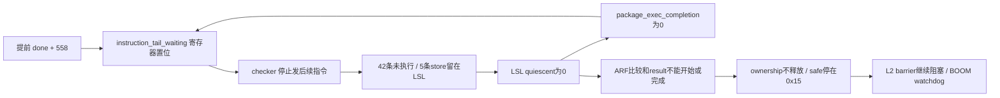

**结论：Confirmed。528000 failure 的首因是包边界的指令计数与实际架构边界分离。** 当前 snapshot/drain patch 允许 BOOM 在 `fsm_cooling/fsm_snap` 排空 ROB，但 `R_IC.ic_counter` 仍只在 `fsm_check` 增加，并在进入 drain 之前的 `fsm_postcheck` 宣告 done。seq=0x16 实际退休 **600** 条指令，发给 checker 1 的最终计数却只有 **558**。checker 正确重放这 558 条后停止，旧包剩余 42 条中的 **5 个 store** 已送入 LSL，无法再被消费；包完成、result、ownership release 和安全水位均被阻断，最终 BOOM watchdog 触发。

最早发布的错误协议状态是 **FST 536427：`ic_counter_1=0x822e`，但旧包 ROB 尚非空、seq/数据路由仍属于 0x16**。第一次可直接量化的计数分叉是 **536537 上升沿**：旧包又退休 3 条，而计数仍为 `done|558`。二者分别是“提前终结的控制状态”和“第一个漏计的架构提交”，不可混为 watchdog 时刻。

本报告只做 RCA。没有修改软硬件、重新生成 RTL、编译或运行仿真；仅新增此报告及 `Debug/rca_528000_20261008/` 中的分析证据。没有设计修复方案。

**证据版本、时间和映射**

- 当前 Git HEAD：`fbca5d0c5ee2a65575ad2b283c7219103684169a`；21 个 tracked 文件有 unstaged 修改，staged diff 为空。分析前后 tracked diff SHA256 都为 `7af6515f4fb9c434fb22979203796e06c38c108c7a9572bd3dd3d0d5e1b49bd1`。
- 本次权威输入：`chipyard/sims/verilator/output/chipyard.TestHarness.v1Config/{test.log,test.out,test.vcd}`。文件时间均为北京时间 2026-10-08 13:55；`.vcd` 实际为 FST，范围 `0..1055402`。FST SHA256：`a15c9a710a7c3865588d716ebee783d3e2b6a04a150f26bfff54baf6eb77fd8e`。
- `gen-collateral` 的相关 SV 为 12:52 生成，debug 二进制为 13:43；全部修改中的硬件源文件时间早于此次生成。关键赋值进一步与 SV、编译后的 Verilator C++ 和 FST 逐项核对，未仅凭 mtime 推定一致。文件哈希见 [manifest](rca_528000_20261008/manifest.txt)。
- 软件 `Software/Test/test.riscv` 和 `test.dump` 为 09-24 版本，当前 C 文件解释程序意图，实际执行以 PC/机器码、dump 和波形一致性为准。启动跳转 `0x80003ab0: 0x00001067`，以及 BFS 循环 `0x800007ec..0x80000824` 与运行观测相符。
- 时间换算来自实际 `gen-collateral/emulator.cc:52,318,324,337,344`：`sc_time_stamp()=trace_count`，FST 在低/高半周期分别 dump `2*trace_count` 和 `2*trace_count+1`。BOOM 时钟上升沿间隔 2 FST，checker 1 间隔 4 FST。本次实际是 **2:1**，不能直接采用源码注释中的 300/100 MHz。
- `[528000]` 是 Verilator `%t` 格式化结果，不是精确的架构 cycle 编号。波形最后为 FST 1055402；watchdog bit 在 1055401 置位，下一 eval 断言先于下一次 dump。生成 C++ `VTestHarness___024root__131.cpp:2738` 使用 `VL_TIME_UNITED_Q(1000)`；以原生 FST 时间作精确比较，不把 528000 乘二当成准确停止边沿。
- checker 1 对应 `tile_prci_domain_1.tile_reset_domain_tile.core`，BOOM `ic_status(1)` / `package_owned(1)`，clear mask 为 `0x02`。

**先验证旧 first-bad 是否消失**

| 旧问题 | 本次实际观测 | 判定范围 |
|---|---|---|
| 空 ROB 读取 stale head `0x800004ac` | FST 393085 ROB 为空时 `r_next_pc=0x80000368`；393095 R_RSU 锁存同一 PC；393253 checker CPS PC 同为 `0x80000368`。下一条 BOOM 实际提交也是 `0x80000368`。 | 旧 seq=1 首坏已消失。 |
| snapshot 接受时仍有退休/无效 PC | 对全程 23 个实际 snapshot 接受边沿检查：全部 `ROB empty=1`、`r_next_pc_valid=1`、`ic_incr=0`；每个 snapshot PC 都等于随后首条实际架构提交 PC。 | 本次已观察到的边界均通过，不宣称覆盖所有控制流。 |
| SyncReadMem 无预取或 payload 消失而 valid 留高 | bank0 在 393261 发读、393265 得 RAM 输出；393269 原始 RAM 输出变 0，但 `lsl_head_payload_0/selected_head` 保持正确 store `0x80087f58`，head_valid=1。393997 deq_fire 拉高，394001 边沿出队。bank1 同样保持 `0x80087f68`。 | 旧同步 FIFO 首坏已消失。 |
| load 错误消费 store | 全程 checker 1/2/3 分别有 1737/712/752 次实际内存 dequeue，共 3201 次；逐上升沿检查全部具有 selected_head_valid、type match、address match。payload 在已置 valid 的保持期没有变化。全程 mismatch/overflow/package error 探针未置位。 | 排除旧错误消费/头数据丢失作为本次首因。 |
| 旧 barrier ACK 后 `functionalBarrierStall` 将 ROB 锁在非空 | 当前 diff 删除此项；本次 ACK 后可见 42 条 drain 提交，536847 ROB 清空，536855 分配下一包。 | 旧锁 ROB 路径在本次已消失；其后出现新的计数不一致。 |

原始证据：[旧修复窗口](rca_528000_20261008/old_fixes_393070_394200.txt)、[全程 snapshot/commit 汇总](rca_528000_20261008/commit_audit_summary.txt)、[LSL 检查汇总](rca_528000_20261008/lsl_audit_summary.txt)。计数采样先归并同一时间戳的全部信号，再用**上升沿之前**的值判断 fire/commit；没有把同一时间戳内打印次序误当电路传播次序。

**必须纠正交接中的一项判断：本次真实 barrier 已启用。**

交接关于“最新 unbarriered run / request 折叠为零”的描述不适用于这份 13:55 FST。当前 `GH_GlobalParams.scala:9` 默认值为 true；更关键的是实际 `BoomCore.sv:6411` 保留 `barrierServiceActive & synchronized_request`，`InclusiveCache.sv:1340,1341,1370,10973` 保留 unsafe 判断、close ACK、watermark 和 barrier_allow 的硬件连线。

FST 536413，L2 写回候选 `valid=1, dirty=1, packetTracked=1, seq=0x16`，安全水位为 `0x15`，因此 `barrierCandidateUnsafe=1`、`barrier_allow=0`；536415 发 request=0x16；536423 BOOM 识别 close。本次根因必须包含这条已实际触发的路径。

**Last known good → first bad → failure**

全局最后一个完整 PASS 包是 **seq=0x15/checker 3**：531809 本地 full_check_complete；531917 对外 result_valid，status=0(PASS)；531927 BOOM clear bit3；531929 ownership 清除且 safe watermark=0x15。全程 seq=1..0x15 共 21 个包均产生 PASS result 并释放。checker 1 自己上一个 PASS 是 seq=0x13，518345 清 ownership。

当前 seq=0x16 的已知正确前缀更靠后：BOOM 在 **536413** 已正确累计 558 条，下一 PC=`0x800007f0`；到 536423 仍是 `fsm_check`、`done=0`、同一 seq。对齐 checker 启动跳转之后的真实提交，前 **558 条 PC+机器码全部相同、零分叉**。因此不能把末尾计数的 +1 认作多重放一条，也不能把最终 `wb_pc=0x800001ea` 的 mret 当作最早错误 PC。

| FST 时间 | 直接观测 | 因果意义 |
|---:|---|---|
| 531113 / 531115 | checker1 ic_status 置 1；随后分配 seq=0x16，snapshot PC=0x8000082c。 | 本次 ownership watchdog 起点；初始 CPS PC 正确。 |
| 531465 | checker 在 checking 状态退休启动跳转 `0x80003ab0`。 | 普通包 `sl_counter=实际指令数+1` 的具体来源。 |
| 536413 | BOOM count=0x22e(558)，ROB非空；L2 unsafe candidate seq=0x16 > safe=0x15。 | 最后正确计数前缀；合法 barrier 触发条件。 |
| 536415 / 536423 | L2 request；BOOM barrierForceClose=1、snapshot_dispatch_block=1。 | 停止新 dispatch，开始关闭当前包。 |
| 536425 | R_IC 从 check(6) 进入 postcheck(7)，停止累计。 | 上游致错状态迁移。 |
| **536427** | `ic_counter_1=0x822e`，done=1；close ACK=1；ROB empty=0；active seq=0x16，crnt_mask=0x21。 | **最早错误发布状态：终结计数早于该包真实架构终点。** ACK 与 producer seal/PASS 是不同事件。 |
| 536429 / 536431 | cooling(3) → snap(4)，退休 stall 撤销；dispatch 仍被阻止。 | 老 ROB 指令现在被允许退休，计数器却在这两状态 hold。 |
| 536433 / 536445 | L2 收到 matching ACK；checker 先收到 count=558，后 `ic_counter_done=1`。 | 排除 ACK 丢失；证明提前 done 真正送达消费者。 |
| 536501 / **536505** | checker 到达 boundary；退休第558条真实指令 `0x800007ec` 后 `sl_counter=559`、instruction_tail_waiting=1，流水线有效数归零。 | checker 按错误发布的边界停下来，下一条应为 `0x800007f0`。 |
| 536535 → **536537** | BOOM 三槽 arch_valid=1，`ic_incr=3`；536537 边沿退休 `0x800007f0/7f4/7f8`，仍 seq=0x16、fsm_snap、counter=0x822e。 | **第一次实质计数分叉：实际累计561，但发布计数仍558。** |
| 536537..536847 | 旧包在 snap 状态总共再退休42条，其中5条 store。 | BOOM 真实包长600；不是物理 cache replay 计数。 |
| 536573..536869 | 5条 store 正常写入 checker1 的 LSL，bank0=2、bank1=3；队首 payload/valid稳定。 | 数据流覆盖42条尾指令，指令流却已停止，出现无法消耗的合法尾记录。 |
| 536847 / 536853 / 536855 | ROB真正为空；producer seal seq=0x16；下一 snapshot 分配seq=0x17，PC=0x80000820。 | producer seal 等到了真实终点，但没有改变早已固定的558。 |
| 536865 / 537013 | checker收到matching seal；ECP complete=1、ECP seq=0x16。 | seal、ECP都送达；LSL非quiescent阻止exec完成和ARF compare。 |
| 539333..1042793 | 卡住后38次 xRET；每次下一checker边沿清 progress timeout；最大3464，远低于65535。 | 本地取消机制被与包进展无关的返回活动反复清零。 |
| 667485 | L2 barrierError=1；request仍保持，safe仍0x15。 | 下游 barrier timeout；不会替代checker结果或释放条件。 |
| **1055401 / 1055402** | `large_1=0x2000,small_1=0`，即little_status1=2^18；最后dump后下一eval断言。 | 对应日志 `[528000] little core 1 has hung`。 |

watchdog 时间闭合为：`1055401 - 531113 = 524288 = 2 * 2^18`。它从 ic_status 置位计时，早于正式 allocation 2 FST；不是从首次坏状态开始计时。

**42条和5个store的交叉核对**

[逐条对比 CSV](rca_528000_20261008/seq22_commit_comparison.csv) 覆盖 seq=0x16 的600条 BOOM提交及558条checker提交，后42条全部标为未执行。全程扫描显示 seq=1..0x15 没有处于非check状态的架构提交，第一批普通漏计确实在本包出现。

| BOOM消费提交边沿 | PC | store地址 | 数据 | checker入FIFO边沿 / bank |
|---:|---|---|---|---|
| 536551 | 0x8000081c，sh a6,0(a3) | 0x80036304 | 0x2d | 536573 / 1 |
| 536561 | 0x80000820，sh a2,0(a4) | 0x80016304 | 0x27 | 536585 / 0 |
| 536699 | 0x8000081c | 0x80036306 | 0x2e | 536721 / 1 |
| 536709 | 0x80000820 | 0x80016306 | 0x26 | 536733 / 0 |
| 536847 | 0x8000081c | 0x80036308 | 0x2f | 536869 / 1 |

GH_BUF 的 store index 为 `0x8a`（有效、checker1、store），branch为`0x8c`。路由直到536857才切换checker2。checker1的 `io_packet_seq/package_seq_reg` 一直为0x16。入口 `m_st_valid`、数据/地址、FIFO enq_fire及occupancy变更匹配上表；最后一条跨 snapshot 的 CDC 延迟并没有把它交给下一包。

因此这不是“LSL凭空多出记录”，也不是“seq=0x17污染seq=0x16”。记录来自正确退休并仍由0x16拥有的store；**漏的是R_IC包指令计数**。BOOM seq=0x17首条 `0x80000820` 在536871才退休，对应另一个store `0x80016308`，与上表严格区分。

**根因与实际硬件结构闭环**

1. `R_IC.scala:318,326,343,348`：当前 diff 把 cooling 的 `if_pipeline_stall` 改为0，把snap改为只在snapshot_accepted时stall；这两个状态的 `ic_counter(i)` 仍保持原值。`R_IC.scala:390` 只在check、当前target、correct_process成立时增加；`:405` 在postcheck对旧计数OR `0x8000`。`crnt_target` 在cooling已切到下一个checker，但 `crnt_mask`/active seq在实际snapshot前仍保留旧归属。这三个边界并不等价。
2. 生成 `R_IC.sv:210,319` 的实际寄存器输入为 `_GEN_7[fsm_state]`：state6加数，state7置done，state3/4回送原计数。`:552` 的stall组合式在cooling/snap确实允许drain。不是Scala看起来有意图但生成成另一套逻辑；这里生成结果直接实现了该漏洞。
3. Chisel连接覆盖也已核查：`R_IC.scala` 中较早的 `cdc_cnt===3` 输出Mux最终被末尾 `io.ic_counter := ic_counter` 覆盖，生成 `R_IC.sv:558` 是连续 `assign io_ic_counter_1 = ic_counter_1`。不能以“四周期输出一次”的源码注释解释漏掉42条，也没有隐藏的稍后计数补发。
4. BOOM `core.scala:2220` 只阻止新dispatch，让老ROB drain；`:2110` 已无旧functionalBarrierStall。`tile.scala:304..326` 实际逐拍寄存提交与 `ic_crnt_target` 给GH_BUF；`GH_BUF.scala:128` 按commit与gh_can_fwd生成记录，不受R_IC的`fsm_check`计数条件约束。生成 `BoomTile.sv:3030,3049,3068,3071` 和 `GH_BUF.sv:169`吻合，故同一批尾提交的“记录有、计数无”可由硬件连线预测，并已被波形证实。
5. `R_ICSL.scala:138,143,147,349,486`：consumer以done/count判断boundary，注册instruction_tail_waiting后禁止新指令进入；只有 `package_tail_drained && pipeline_empty && !inflight` 才完成。生成 `R_ICSL.sv:145,148,321,539` 对应这些条件。
6. `RocketCore.scala:1423,1426,1434,1442`：tail、ARF compare及package_data_complete均要求LSL quiescent。生成 `Rocket.sv:3112` 将真正 `_lsl_io_quiescent` 接给ICSL，`:1110,1111` 将ICSL stall接入decode kill；没有missing IO、DontCare或同名未连接的证据。

实际等待环为：

这里是**跨寄存器的状态等待环**，不是把历史的FIRRTL纯组合环重新命名。生成RTL显示 `instruction_tail_waiting` 是reg，clear条件包含exec_completion；波形显示时钟、中断和返回持续活动，而该package不再推进。producer seal成功阻止了较早的LSL短暂无数据窗口被误判为整个包已完成，但seal没有携带/补齐最终指令数，不能解除这个状态等待。

**Broken invariants**

- 同一seq的最终指令计数、CPS→ECP架构区间、GH_BUF数据/分支记录，必须描述同一个退休前缀。这里 `count=558`，架构区间及记录却覆盖600条。
- done代表最终边界；在done之后又归属于该包的合法退休，必须已经被这个最终计数覆盖。本次done后的42条均未覆盖。
- checker禁止后续指令后，仍须存在消费所有本包剩余记录并终结的路径。本次剩余store对应尚未执行的指令，却又用LSL为空作为解除等待条件。
- 有限no-progress取消不能被无包进展的周期性活动无限延期。`RocketCore.scala:1468..1471,1633`直接把`csr.io.eret`算成progress；运行中38次eret后的下一拍均清计数。ARF timeout因LSL非quiescent不启用；exec timeout因package_data_complete=0不启用。

**与历史修复的关系和置信度**

| 层次 | 结论 | 置信度 |
|---|---|---|
| 直接症状 | checker1 seq0x16无release，ownership watchdog达到2^18 | Confirmed，计数值及时间差精确吻合。 |
| 立即阻断 | 指令已停、5个store待消费，LSL quiescent=0，exec/ARF/result均不能完成 | Confirmed，生成连接及实际尾记录匹配。 |
| 上游首因 | drain扩大了旧包退休范围，R_IC仍提前终结并只统计fsm_check | Confirmed，600/558/42精确计数、558条PC+机器码对齐、当前diff和生成RTL闭环。 |
| 触发 | 活动包seq0x16的合法L2 barrier close遇到非空ROB | Confirmed；不是barrier参数被关闭，也不是5000条threshold触发。 |
| 下游放大 | 周期性xRET清progress timeout；safe不前进使L2不release | Confirmed；matching ACK已到，watermark条件未到。 |
| 相对旧PC/LSL首坏 | 新的不同缺陷，旧first-bad在本次已消失 | Confirmed，直接重查旧时间点及全程相关invariant。 |
| 相对当前patch | snapshot/drain修复覆盖不完整；相对Git基线是开放drain退休与旧计数契约组合产生的regression | Confirmed结构归因；没有逐个历史patch提交可供进一步bisect，不能指定某个未保存的单独改动版本。 |
| 与口述514000是否同根 | 没有版本匹配的514000日志/波形，不能断言 | Candidate/未确定，仅凭failure时间推进不作推断。 |

已阅读的515000旧抽取显示 `ACK=1、ROB gh_stall=1、ROB empty=0` 一直保持；当前则实际drain完成并分配下一包。它支持“旧阻塞机制已消除”，不能证明旧运行已经存在本次42条漏计，也不能将旧时间点移植到当前运行。

**已排除的重要假设**

- 旧stale-PC或ARF捕获提前导致当前错误重放：本次CPS起点正确，前558条完全对齐，之前21包PASS；当前ARF比较根本未开始，不能把ARF差异当作已观察首因。
- SyncReadMem无读、原始输出失效导致head消失、错误类型dequeue：当前注册payload正确保持；全程3201次fire及有效载荷检查通过。
- CDC丢失尾数据、错seq或FIFO容量溢出：5个尾store的BOOM→GH_BUF→checker入口→FIFO边沿逐项一致，无overflow/transport error；最终占用2/3远非容量限制。
- producer seal没来、ECP没来、result CDC丢失：seal及matching ECP均已来；result尚未形成，不能指责result传输丢包。
- barrier ACK没来，或ACK应自动释放L2：536433 matching ACK已在L2；实际release还要求seq<=safe，0x16>0x15所以不满足。
- 旧L1 crossPackagePending/错误TtoB/影子写回重发作为本次首因：本次L1 crossPackagePending全程为0；实际触发来自L2。未把这点扩大为对所有cache/token路径的全面正确性认证。
- 物理store replay重复导致多出来5个记录：这5条各自有独立ROB架构提交和不同地址，属于42条未执行尾部，不能用cache写脉冲解释。
- checker本来多执行/少执行一条的off-by-one：启动跳转已从序列中独立剔除，558条真实PC+指令完全一致；缺口是42条，不是1条。
- 单纯watchdog太短：本包稳定陷入状态等待；精确超时只决定停止时刻。

**检查边界与复现资料**

证据目录：[rca_528000_20261008](rca_528000_20261008/)。保留原始二进制值抽取、600条提交对比CSV、关键diff及hash；本报告十六进制值都由二进制显式转换。关键抽取命令见 [commands](rca_528000_20261008/extract_commands.txt)。

只读invariant脚本仍报告bounded-progress等源码marker存在，未发现本次“done早于drain”的跨模块语义问题；它的PASS没有作为正确性证据。`git diff --check`仅报告已有Experiment文档空白问题。本轮没有进行新的Scala compile、elaboration、RTL生成、仿真或反事实验证；根因Confirmed来自**已经生成并实际运行的硬件**与当前源码/diff一致的直接证据，而非仅靠源码推演。
