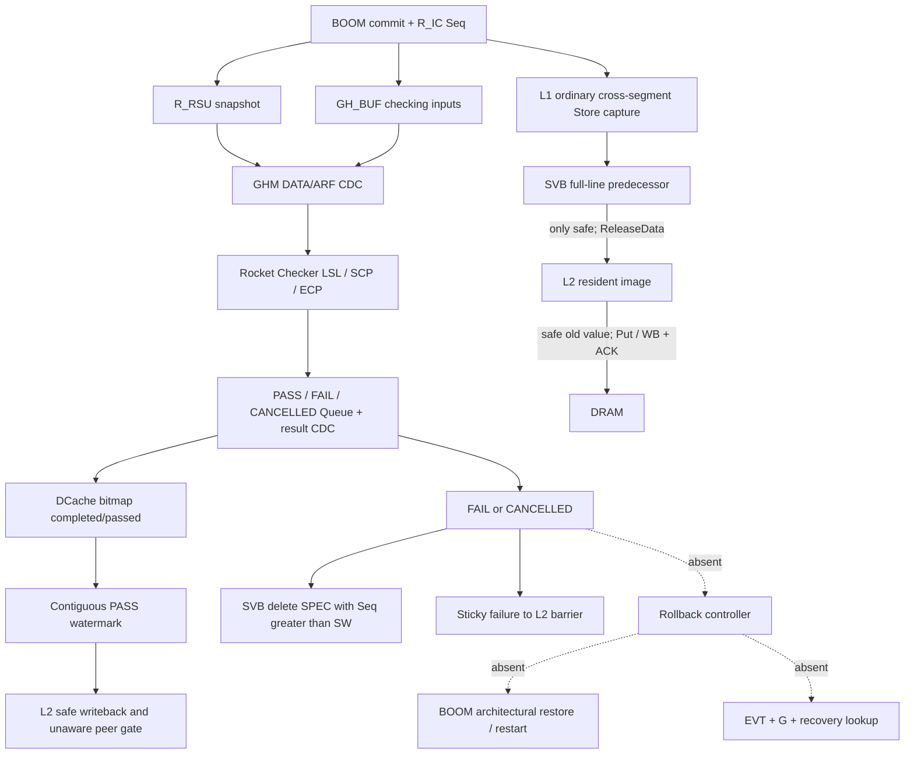
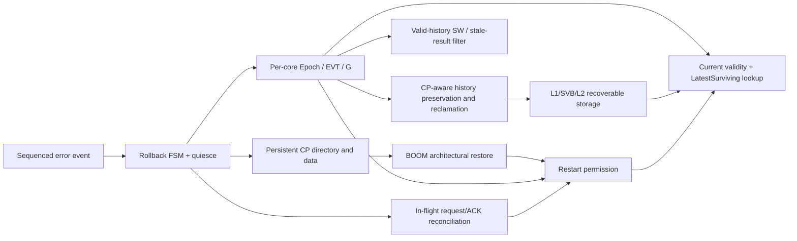

# PALIMPSEST Rollback / Recovery 差距

## 结论与证据范围

**当前不能完成论文 Figure 4(b) 的 A8→A7 恢复。已有 cache 数据存储、内容身份、保存责任和可靠 ACK 是可复用基础；但缺少恢复主控、持久 CP 服务、主核状态导入、有效历史和恢复读取协议。现有 FAIL/exception 清理还可能主动丢弃应保留的历史。**

版本：2026-11-21，HEAD `75f2905693d6eec3b92d733e65bafa7a9c4be6dc`，分支 `firesim/fpga-checkpoint-20261104`。Chipyard 代码无未提交修改，审计前只有论文目录未跟踪。本轮无构建、RTL 生成或动态故障注入；以下“事实”均为当前 Chisel/Scala 路径，“推演/风险”明确单列。论文 SHA 与正常运行证据边界见 [00](00_PALIMPSEST_Overview.md)。源码路径相对 Chipyard，E01–E27 引用 [01 证据索引](01_PALIMPSEST_Feature_Matrix.md#evidence-index)。

## 1. 论文要求的恢复流程

论文 III、IV-A/B/D/E/F、Algorithm 1 与 Figure 3 共同要求：

1. 收到本核 Segment n 的错误，取得 n 开始时 SCP；停止该核继续扩展错误历史。
2. 恢复 SCP 中 PC、架构寄存器及所需架构状态，flush 错误执行的流水线状态。
3. EVT 作废从 n 起的有效历史后缀；n 之后已经 PASS 的段也不能保留，因为它们依赖被放弃的执行。此前有效区间跨 Epoch 保留。
4. 用新 Epoch 和从不复用的更大 Seq 继续执行；推进该核 generation G，使旧 Current mapping 失效，而不清空历史数据或扫描全部 cache。
5. 重启前协调在途 request/transfer/ACK，使它们不能把旧执行内容重新安装为有效 Current，且已接收的总线责任得到处理。
6. 恢复后普通 Load 首先验证 Current mapping；遇 stale mapping 时按地址在缓存层次查询，过滤 EVT 不再有效的版本，选择 LatestSurviving。不存在合格缓存版本且 DRAM 确为所需值时才使用 SafeBaseline。
7. 将选中版本提升为新 G 下的 Current，正常处理后续 Load/Store；新段首次 Store 仍按 CP/EVT 判断是否保留 predecessor。
8. SW 只跨有效且已 PASS 的历史推进，跳过被 EVT 作废的区间；只有版本本身有效并且 Seq≤其 producing core 的 SW 才能外传。

步骤 2–5 的具体串并行安排、quiesce 是否完全 drain、CP RAM 放置不是论文固定实现。必须有共同的“恢复提交/允许重启”边界；不能在旧事务仍可覆盖新状态时放行。

```mermaid
sequenceDiagram
    participant C as Checker
    participant R as RollbackController
    participant M as Main core
    participant P as Context Memory
    participant H as History EVT/G
    participant K as Recoverable cache
    C->>R: Error(core,n)
    R->>M: Stop and flush discarded execution
    R->>P: Pin and read SCP(n)
    P-->>R: PC / architectural state
    R->>K: Quiesce and reconcile in-flight transactions
    R->>H: Invalidate suffix, create Epoch, advance G
    R->>M: Restore architectural state
    K-->>R: Transaction responsibility reconciled
    H-->>R: History state committed
    R->>M: Restart at SCP with fresh Seq
    M->>K: Load A
    K->>H: Validate mapping/history
    K->>K: LatestSurviving(A), else qualified SafeBaseline
    K-->>M: Surviving data; map as Current under new G
```

图为目标语义，不代表已有接口；缓存按需恢复可发生在重启之后，不需要启动前扫描全部地址。

## 2. 当前实际控制/数据路径



已确认：结果路径 Queue/CDC（E03）、bitmap（E09）、capture（E13）、下推与 lower commit ACK（E17）、L2 安全外写（E19/E20）。虚线是缺失功能，不是尚待接上某根已有恢复线。

`generators/boom/src/main/scala/lsu/speculative-version-buffer.scala:242` 的 `recoveryFromSvb := io.acked`，由 `dcache.scala:1603` 的 promote→WB 和 `:1614` 的 ReleaseAck 完成驱动。该计数只说明历史快照已下推并收到回执，不能作为一次 rollback memory recovery 成功的证据。

## 3. Error Detection 到 Execution Restart 的逐步骤对照

| 步骤 | 当前事实及定位 | 状态 | 未闭合的必要条件 |
|---|---|---|---|
| 内存/寄存器/CSR mismatch | ELU error_ld/st、R_RSUSL compare_done_error、CSR shadow；E08/E24 | Partial | 结束比较跳过 f0；PC/FCSR 完整覆盖及 fault→结果路径仍需定向验证 |
| 形成并交付 Error(n) | RocketCore:1525/1535，GHM:559/565/576，DCache:2543 | Implemented | 当前仅 `{status,Seq}`，多主核/跨执行历史需补身份与错误类别 |
| 选择错误及冻结历史扩张 | DCache:2561 保存首个 checker 优先选中的 Seq；未驱动恢复 | Missing | 最早有效错误仲裁、停止 allocation/commit、保留 CP/事务责任 |
| 找 SCP(n) | Checker 内存在 SCP RAM，E07/E08 | Partial | 可寻址目录、有效性、pin/read/restore ACK、与 slot 复用分离 |
| 恢复 BOOM 架构状态 | BOOM core:2349 起 CSR 导入常量关闭，E25 | Missing | PC、int/FP PRF、rename/map/free/busy 状态、CSR 原子恢复 |
| flush/discard 请求 | 有通常 branch/exception/ROB flush、replay cancel，E14/E26 | Partial | failed-history 的 committed 后缀、STQ/MSHR/refill/WB 的恢复协议 |
| 作废错误后缀 | SVB Seq>SW 删项，resident/L2/bitmap 未作废，E21 | Different | 以 EVT 作废 n 及后续有效历史，保留 n 前 unsafe 数据 |
| 切 Epoch、Seq、G | counter 正常递增；本地 epoch 因 exception 变化 | Partial | 持久跨 Epoch 区间、fresh Seq、逻辑映射 generation |
| 处理在途 request/ACK | 正常精确 key/txn 匹配与责任保持，E17/E20 | Partial | quiesce_done、discard/accept 规则、旧异步响应不污染新映射 |
| 发布恢复完成及 restart | 无恢复状态机/接口 | Missing | arch_done + history_done + transaction_done 后才重启 |
| 首次 Load 选择 A7 | 普通 tag hit 或普通 refill；无 SVB recovery read | Missing | staleCurrent、跨层候选过滤、LatestSurviving、安装新 Current |
| 后续 SW/版本回收 | 连续数值 PASS，FAIL 槽阻断推进 | Partial | 跳过废弃区间、拒收作废结果、按有效 CP 判断 NeededForRollback |

源码行号简写在表内继承 E 索引中的完整相对路径，不是 generated RTL 的行号。

## 4. Architectural Recovery 与 Memory Recovery 必须一致

当前 BOOM `core.scala:2007` 保存的是提交观察 shadow，用于输出快照；它既不是重命名 PRF，也不是可按 Seq 读回的多份 CP。Rocket `R_RSUSL` 的 restore 输出真实写到 `RocketCore.scala:1672` 的 RF 和 Checker FPU/CSR，但未接回 BOOM。仅对 shadow 数组赋值无法恢复 BOOM 执行状态。

恢复到 SCP8 必须使 int/FP/CSR/PC 和随后可读内存共同对应“Seq8 开始前”。若只恢复 PC/寄存器而仍命中 A8，重执行输入错误；若只清 cache 而取 A1，内存落后于 SCP8；若新 Epoch 已开放而旧 MSHR 随后安装 A8，则恢复点被破坏。

需要持久 CP 生命周期，而不只是快照流。Checker slot 当前在结果交付后释放（GHM:575、R_IC:268），R_RSU 只有一组可覆盖寄存器。可选择新增集中 ContextMemory，或复用分布式 Checker RAM 并增加 pin/读取端口/跨域传输；后者必须证明发错结果时 SCP 仍存活，且其他未完成 CP 在连续回滚后仍可定位。完整 CSR 集合、TLB 清理、中断和不可回放计数器策略是实施前设计待决策。

## 5. 关键身份状态不能混用

| 名称 | 当前存储/更新及硬件效果 | 是否满足论文含义 |
|---|---|---|
| Seq | R_IC:130/278 分配；LSQ 锁存，CacheImage.contentSeq 跨层传播 | 可复用正常序号源；未配套回滚有效历史 |
| producing core ID | CacheImage.writer 是 BOOM cache 静态 namespace，dcache:541/3343 | 可作为内容来源基础；需明确到恢复核历史的映射，不是完整按核 SW/EVT 路由 |
| CacheImage.generation | imageSerial 每次物理 semantic write 自增，dcache:3319/3334/3344 | 内容身份，**不是** CurGen 或本核 G |
| slotEpoch | L1 set/way 的物理 incarnation，dcache:704 | 防止旧 owner 操作新槽，不是执行 Epoch |
| svbEpoch / snapshot.epoch | 当前 SVB 本地 epoch；exception 自增、traffic_reset 清零，dcache:2572 | 未进入 CacheImage、L2 或执行区间表；不满足 IV-A/E |
| ecp_frame_epoch | R_RSUSL:177/403，识别当前 ECP 帧/比较 | Checker 帧身份，不是主核执行历史 |
| session epoch | GH_GlobalParams:30/36，用于 START/FINISH 会话控制 | workload 会话身份，不是 rollback Epoch |
| EVT | 无执行有效区间表/查询/更新接口，E25 | Missing |
| Cur / CurGen / G | 普通访问为 resident tag/coherence lookup，E14/E16 | Missing；需保留独立逻辑映射语义 |
| CP 集合 | Checker 各有本地起止快照，没有版本回收用的 outstanding CP 目录 | Partial |
| SW | 正常连续 PASS 前缀，错误后留洞且 sticky failure 无恢复清除 | Partial |

由于 Seq 设计为不复用，未来可把执行 Epoch 与 Seq 的映射压缩到区间表；但无论选择随 key 传 Epoch 还是通过不歧义 Seq 区间推导，都必须明确满足论文的有效历史语义。现有本地 epoch 无法提供该关系。

<a id="figure4b"></a>
## 6. Figure 4(b)：A1 / A7 / A8 的 RTL 级推演

### 初始条件

按论文目标，DRAM[A]=A1；Seq7 曾把 A 写为 A7，Seq8 开始前 SCP8 已保存。Seq7 尚 pending，SW=6（或更低）；Seq8 普通 cacheable Store 要写 A8。为展示当前能达到的最强路径，假设普通 M_XWR 命中、SVB 有空位、无其他冲突、快照整行捕获成功。它不是本轮仿真结果。

| 顺序 | 论文期望 | 当前 RTL 实际动作/限制 |
|---|---|---|
| 1. Seq7 写 A7 | A7 标生产段 7；保留必要 baseline | dcache:3319/3342 生成 key K7={writer,serial7,Seq7}；数据写入 L1，lowerPreserved 撤销。底层 baseline 可保持 A1 |
| 2. Seq8 开始 | 保存 SCP8 | 分段和 Checker SCP 传输存在；Main 端没有持久 SCP8 定位/读取接口（E07/E08） |
| 3. Seq8 首写 A | A7 转 Historical，A8 成 Current | dcache:1786 满足 SVB eligibility；WB 读取整行 A7，:1878 capture.fire 后放行 Store；A7 在 SVB SPEC，A8 在 L1 resident。这一步有真实可复用的保存基础 |
| 4. A7 等待 | A7 即使未验证也必须存活 | SVB:125 要 Seq≤SW 才能下推；因此 SW6 时 A7 留在 SPEC，不可能已被 safe promotion 完成释放 |
| 5. Checker 报 FAIL8 | 请求 Rollback(core,8) 并 pin SCP8 | RocketCore:1525→GHM:576→dcache:2543 能报告 FAIL8；**首先失败的控制步骤：没有 Rollback 请求输出/接收者、SCP8 读取和恢复主控** |
| 6. 处理历史 | 作废 Seq≥8，保留 Seq7 | dcache:2570/2571 实际发 invalidate(cutoff=6)；SVB:315 删除所有 SPEC Seq>6，**A7 被删**。这是独立的存储语义断点；并非仅缺失控制线 |
| 7. 恢复 CPU/mapping | 恢复 SCP8，advance G 使 A8 mapping stale | 当前均无对应动作；FAIL 没有清除 A8 resident。通常 exception/ROB flush 也不代表恢复 committed Seq8 |
| 8. 读 A | 查到最新有效 A7，拒绝 A8/A1 | 正常 Load 可继续 tag 命中 A8（dcache:1049/1173）。即使人为清掉 A8，若下层仅 A1，普通 refill 返回 A1；SVB 无地址查询端口，A7 已可能丢失 |
| 9. 新执行 | 新 Epoch、fresh Seq，晋升 A7 后继续 | 没有 EVT/G/restart 协议；counter 仍可正常递增，但 bitmap 被 FAIL8 留洞，不能自然跨过已废弃段 |

注意：表中第 2 步的 SCP 流可以产生给 Checker 的副本；缺失的是恢复可访问性和保留保证。因此从“已经报告 FAIL8”的恢复启动链看，第一个失败点是第 5 步；从更早的恢复基础建设看，持久 CP 服务在第 2 步已不完整。两者不能混为“当前没有任何快照”。

若 A7 已在 L2：普通跨层路径确实能取回一个 L2 resident image；但当前没有证明它是地址 A 的 LatestSurviving。若 A8 还在 L1，访问不会主动绕开 A8；若 L2 已接收另一版本，其 directory 不保留任意同址历史。若 SVB 满或请求为 RPQ/AMO/SC，则第 3 步会退到 WaitSafe，具体时序与论文不同；不能因此宣布所有历史都没存过。

假设原执行已分配至 Seq10，正确恢复应将 e0 的有效区间裁到 7，令 8–10 无效，在 e1 从 Seq11 开始，G 增加。A7 可以来自 e0，但被映射为 e1 当前 G 的 Current，内容生产身份仍应保留 e0/7。若 Seq7 随后 PASS，SW 可经有效区间继续推进；若 Seq7 后来 FAIL，必须还能恢复到 SCP7，不能把第一次恢复当成所有旧 checkpoint 已消失。

## 7. 保存/隔离基础能否直接支撑 Rollback：10 个回答

| 问题 | 当前判断 | 需要的扩展 |
|---|---|---|
| 1. 历史是否能辨认哪次执行？ | key 可唯一指认局部内容和 Seq，但不能表达该执行历史是否已废弃 | 执行 Epoch/EVT 及 Seq→history 关系；持久内容 key 不应因验证被改写 |
| 2. Seq/Epoch/Core ID 是否贯穿？ | Seq+writer+内容 serial 可跨 L1 C、L2 directory 和 D 返回；执行 Epoch 没有贯穿 | 增补字段或可靠区间推导，接到每核历史查询；不能复用本地 slotEpoch |
| 3. 能保证所有未完成 CP 所需值不丢？ | **不能。** 现有删除规则构成 A7 反例；无 CP 集合输入，exception/RESET 也删 SPEC | NeededForRollback(CP,EVT)、pin/reference 或等效保留证明，保护正常 trap/测量边界 |
| 4. 可直接复用版本存储？ | 可复用 data RAM/line/key 与 capture、WB；不能原样作为可恢复存储 | 增加历史有效性/恢复读口/原子安装以及 CP-aware 回收；L2 历史容量和查询需扩展 |
| 5. 不重构整个 Cache 能做 LatestSurviving？ | **有可行增量路线，尚未实现/验证。** SVB 是关联存储，有数据；L1 普通路径可保留 | 在冷恢复路径增加地址+EVT 查询/最大候选比较，L2 增历史 ways/sidecar；逐层聚合，不可只扩一个比较器 |
| 6. 已有 invalidation/recovery 接口？ | 有 SVB invalidate/flush、本地 completion/cancel、cache 普通清理 | cutoff 和作用域不适配论文；没有恢复查询或 G 失效接口；现有 SVB promote 是下推 |
| 7. 可避免读废弃 Current？ | 当前不能；普通 Load 不查询历史有效性 | G/CurGen 等效 mapping validation，停止期及恢复 install 的原子保护 |
| 8. 能从 L2/DRAM 取恢复值？ | 普通数据传输存在；正确版本选择不成立 | 带 history context 的 query/result、baseline qualification、恢复到新 Current 的 install |
| 9. 在途事务是否可能破坏？ | 当前未实现 Rollback，不能声称已发生恢复竞态；未来直接接入会留下旧 refill/C/ACK 责任 | drain/mark/discard 协议、reservation incarnation、对旧 ACK 只清原责任、同址传输序列化 |
| 10. 沿用/修改/新增什么？ | 沿用 checkpoint 采集、Seq、Queue/CDC、line data、key/txn、bank ports | 修改保留/回收、bitmap、coherence/IO、流水线恢复；新增 CP 服务、Rollback FSM、EVT/G 和 recovery 查询协调 |

## 8. 复杂场景、竞态和一致性

### 8.1 错误段之后有已 PASS 段

例：Seq9 PASS，Seq7 pending，Seq8 FAIL。当前 bitmap 会保留 Seq9 completed/passed，但不能推进跨过 7/8。论文要求 8 及之后的原执行历史作废，包括 9；未来新 Seq11 PASS 不能借 Seq9 的旧 PASS 越过错误。需同时处理位图、Checker 任务、DATA/ARF/END、结果 CDC 与 CP pin：有效前缀的迟到 PASS7 可保留，已废弃后缀的 PASS9 必须丢弃，不能仅凭“Seq 大于 SW 且已分配”接收。

当前 `barrierFailureSeq` 是首次 checker 优先选择，非多个错误的最小有效 Seq（dcache:2558/2563）。若并发 FAIL8/FAIL10，未来主控必须选择满足恢复语义的最早有效错误；连续回滚时还要过滤已作废错误，而不是永久使用 sticky 值。

### 8.2 同址跨多个段反复写

A7→A8→A9 可以在可满足 SVB capture 条件时产生多个完整快照。当前 safe coalescing 只对已安全的同 writer 同址版本比较 Seq/serial，避免较旧安全值后来覆盖较新值；这可以沿用。恢复到 SCP9 需 A8，恢复到 SCP8 需 A7，恢复到 SCP7 还可能需 A1；“保留最新 safe”并不足以服务所有 outstanding CP。

正确谓词是：版本 v 是否为**某个仍可回滚 CP 的最新有效 predecessor**，不是简单 `v.Seq > SW` 或“尚未检查”。多次同段 Store 可覆盖中间值，因为 SCP 对准段起点；继承整行并应用 byte mask 必须保持未写字节与前驱一致。AMO/SC 还需定义失败不产生新版本、原子返回值和一次性效果。

### 8.3 跨 L1/L2 历史保留及替换并发

L1 capture→SPEC→safe promote→L2 lower-commit ACK 的正常责任链较完整。L2 `L2Preservation` 却是 safe old image→原地址 DRAM Put，并不是 unsafe 历史向另一 L2 way 迁移。旧 unsafe resident 被异 key 覆盖时，它选择等待 SW，可能把压力推回主核。

若新实现允许错误后清 Current 而保留 history，替换逻辑必须区分物理 valid、history-valid、current-mapping-valid、preserved certificate。现有 L2 多命中 Mux1H 不支持直接出现若干相同 tag；应先定义唯一 Current lookup 和独立 history lookup，避免普通数据选择混叠。恢复读、capture、replacement、Probe 和 refill 对同 set/way 的仲裁需复用现有 freeze/drain 并新增恢复 reservation。

### 8.4 回滚遇未完成 Preserve/WB/ACK

| 在途状态 | 当前有的保护 | 恢复时必须新增的规则 |
|---|---|---|
| snapshot 正在读取，尚未 capture.fire | freeze descriptor 和 drained 检查，E13 | 先完成捕获或确认未覆盖；不能删 producer 并同时放行 Store |
| SVB SPEC，未安全 | 完整 immutable line/key | 对 surviving history 保留，对 discarded history 失效；不按 SW 一刀切 |
| SVB WB_WAIT，C 未全发完 | active entry、shared source owner、held payload | 已接受 packet 责任不能直接中断；恢复状态不得重用 source/entry |
| C 全发，ReleaseAck 未到 | pending key/entry，末 bank commit 后 ACK | 旧 ACK 仅清原 transaction 的责任，不能把弃用内容标成新 Current |
| L2 safe Put/Release 已发，DRAM ACK 未到 | serial echo、set lock、等待完整 ACK | 允许仍有效 safe baseline 完成；不可在恢复 install 前错误释放锁或复用 txn |
| MSHR Grant/LineBuffer/RPQ 未安装 | slotEpoch、transaction token、replay effect completion | 作废历史的 refill 不能再安装有效 Current；总线 D/E 责任仍需 drain |
| peer request 已 park 或 probe 在途 | 等待槽不占 MSHR/set，E 独立完成 | 按 producer history 重查，不把废弃 Seq 的“数值上≤新 SW”视为安全 |

最后一项尤其重要：当前 `CacheImage.safe` 只比较数值 Seq。如果仅新增“SW 跳过作废区间”，而不增加 `HistoryValid(v)`，当新 SW 变大，旧 A8 会被错误视为 safe。当前 RTL 因 FAIL 留洞通常不会到达该状态；这是**未来局部实现 Rollback 时确定需要避免的组合错误**，不是本轮已观测的 unsafe DRAM 写。

### 8.5 常规 exception 和测量 RESET

直接事实：`dcache.scala:2569` 将二者连到 SVB flush，`common/tile.scala:669` 的 RESET 是性能控制位；`SVB:324` 清 SPEC。它们并未检查“这些值是否仍是某 CP 唯一可用前驱”。已有正常 manifest 甚至记录 3 次 flush-discard；这说明该分支有运行证据，**不能仅凭计数证明已丢失某个必要 A7**。应补 CP-aware oracle 和断言，而非把每次 flush 都直接报告为已观测数据错误。

### 8.6 两个 Main 独立 Seq/Epoch

当前 GH_NUM_BIG_CORES=1；单 SW boring source、GHM result dequeue clock0 和 image-aware 豁免均体现该适用边界（E01/E03/E18/E22）。把参数改为 2 不会自动产生两个独立恢复域。

需要每核 `{Seq,Epoch,EVT,G,SW,CP}`、writer→core 路由、结果和错误事件归属以及跨核可见性判定。A 核读取自己 unsafe 当前值可以允许；B 核读取/获得 A 核 unsafe ownership 必须等待 A 核有效历史和 SW。B 核取得安全值后的新 Store 才转入 B 自己历史。A 独立回滚不应清 B 的版本或事务，同时也不能保留来自 A 废弃历史的跨核可见效果。

### 8.7 Forward progress / 死锁

已有：L2 safe runnable 优先、drain 停新工作、set lock、unaware peer park/replay、barrier close、checker timeout；均有具体作用。未闭合：L1/SVB 满时所有等待是否可触发正确的 producing-core close；snapshot 需 ROB empty（core:2213），若旧内存请求占资源阻止该 ROB 清空、而资源释放又等待该段检查，可能形成依赖环。

这是源码结构支持的**潜在环路**，本轮没有构造可达性证明或动态死锁轨迹。timeout→CANCELLED、barrier error、LONG_STALL printf 都不能打破它并恢复正确执行。需在配置受限 fixture 中验证，必要时预留 capture/checker/close/drain credits，并保证 pending coherence 相对后续冲突写的优先级。

## 9. 缺失模块与依赖



建议新模块名如 `RollbackController.scala`、`ContextMemory.scala`、`ExecutionHistory.scala`、`RecoveryCoordinator.scala` 只是设计建议，当前均无相应实现；真实修改位置和验收见 [03](03_PALIMPSEST_Implementation_Roadmap.md)。

## 10. 最小可行单核恢复的必要条件

1. 起步即选择支持的范围，例如一个 Main、普通 cacheable Load/Store、有限连续回滚；其他操作必须在进入前正确封段/等验证，不能只在测试中避开后宣称完整。
2. 错误事件到恢复主控和稳定停止边界闭合，能 pin/读目标 SCP；并发错误和 CANCELLED 的处理策略明确。
3. 主核 PC/int/FP/所需 CSR 和 rename/PRF 状态在同一恢复点完成；所有可回滚 CP 仍可用。
4. 保存规则保证 A7 等 surviving unsafe 历史不丢；引入有效历史和 mapping generation，废弃 Current 不能命中。
5. 有按地址的恢复候选查询、跨必要层次的最大有效版本选择、受条件约束的 DRAM fallback，以及恢复安装。
6. 在途责任有 drain/隔离协议；恢复提交前所有旧事务已结束或只能产生不会污染恢复的新动作。
7. 证明 fresh Seq、废弃结果过滤、SW 跳洞和 safe 写回同时正确；连续回滚保留跨 Epoch 历史。
8. Figure 4(b)、A7 仍 pending、后续 Seq9 已 PASS、旧 ACK 晚到和资源压力场景均以架构/内存 oracle 验收。

可以先分阶段在恢复主控处停止来验证中间条件，但在 memory selection 和在途协调完成以前，不能将“PC 已回到 SCP”称为可运行 Rollback。整 cache 清空到 A1、顺序 undo log 或立即把 SW 抬到 failedSeq 都不满足本论文机制。
