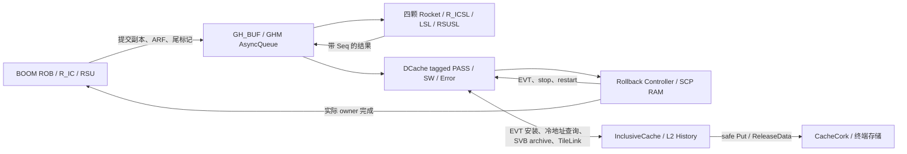

# 单主核 RTL 架构

当前验收（2026-11-24）：69项功能VERIFIED；当前5模型/12完整程序/31负例与严格联合评分全部PASS。来源、范围和独立物理状态见[系统验收](System_Acceptance.md)。

当前目标配置为 `chipyard.v1Config` 的一颗 BOOM Main、四颗 Rocket Checker、单 bank InclusiveCache、64 B cache line。功能状态逐项见 [实现矩阵](Feature_Implementation_Matrix.md)。

R_IC 管 producer 和 Checker 槽。GHM 在数据、ARF、count、result 队列间保留各自的生命周期。DCache 独立维护已分配、已完成、PASS 的带 tag bitmap。SCP RAM 持有已提交 PC、整数/浮点寄存器和 CSR 的起始状态。数据历史只在 L1、SVB、L2 sidecar 和终端基线间移动。

EVT 记录已废弃的 Seq 区间。普通恢复只切换 CurGen 并安装 EVT。第一次访问 stale line 时，L1 从可用候选选择最新存活完整行，必要时还旧权限再经 MSHR 安装。只有 EVT 资源维护需要顺序走访物理目录。Figure 4 在 SW6、Pending7、FAIL8 条件下必须恢复 A7。SW 只控制安全发布资格。

硬件资源的主要增量是 SCP RAM、现有写口上的 PRF 顺序导入、带 tag 的 SW 表、SVB、每 bank 64×512 bit 的历史数据 RAM、每 TL source 的请求等待槽和目录中的过时位。History 的 capture、query 和 publish 使用同一索引扫描。可信 A 写复用该查询端口，Scheduler 增加一个检查中的 MSHR 标记、一个地址和结果 Seq，以及小量控制位。见 [成本审查](../15_SingleCore_RTL_Cost_Review.md)。

Scheduler 在 SinkC 接受拍后暂存完整 C 行，并在向 History 移交前复用目录口核对安全收据。过时目录条目的 `image` 保留已确认基线的版本。MSHR 仍保留该行的物理权限，保证旧 C 可结清。复用原两拍队列和一份 C 暂存行。

本批恢复/I/O接口修复复用既有状态：LSU只屏蔽stop期间未获得内存owner的执行offer；未提交uncached AMO在设备授权时绑定active_packet_seq并存回原STQ字段；IOMSHR独占其旧值响应，DCache terminal仅结清STQ。GHM持有FINISH，直到原forwardDrained证明最后包已被Main释放且发送队列排空。没有增加寄存器、队列、RAM或FSM。生产整核验收由function_closure_regression.py记录固定来源及每次运行/严格计分退出码，全部成功后才可提升任务。

后续实际有限owner审查修复了真实slot epoch0xffff→1分配与install/refill
三处普通+1不一致：统一复用原nextSlotEpoch，不新增状态；生产SBT生成的
完整Hierarchy和长期边界四次同组替换均PASS。GHM维护许可在Main域先
注册，实际新增4bit（每Checker一位），防止多条件组合毛刺进入同步链；
数字四相/FINISH和生产综合均通过。同步器不新增，后端XDC保留原flop并
禁止SRL。生产GHM同top综合LUT98895/FF336652，5ns内部WNS+1.448ns；
与原报告差值含维护4bit及禁止SRL/合并的物理映射影响，未布线和端口延时
未约束，FIFO总线偏斜/数据CE仍未签核。完整组合Seq16实际23次物理重基与新Seq1 PASS已经通过；新Scheduler来源的相关重基回归独立进行。

当前生产已包含GHM源域请求寄存（共4bit）、L1有限slot跳零、Core真实seal回执和最小scratch shadow RMW。CSR保留normal物理/management/MPRV语义，shadow的W/S/C使用本包CPS旧值。宽范围normal shadow bank候选已经否决，不属于当前实现。双FAIL只扩展测试f0注入参数，默认空不生成额外注入状态；专用配置在Seq8、Seq24各注入一次，结果仍经原比较器及GHM。完整任务/构建/动态/物理状态分别见System_Acceptance.json。

2026-11-24：IOMSHR effectPending覆盖受保护Seq非零的live状态（A请求、D等待、终态响应）与未安全的retained journal。live busy仍是原状态，drain不等待孤立journal。该组合输出沿用DCache→Tile→Core的原连接，Core的IoBoundary/重基责任不再在设备ACK之前出现空窗。真实组件与整核状态见System_Acceptance.json。

2026-11-24：Scheduler同组C/BC优先级允许仅含外层E的现有调度包完成。该GrantAck不访问bank/目录，避免C等History、History等已接受外层E、E又被C抢占的循环；所有原发布锁和数据门控保留。组件、当前五配置12完整程序及严格联合验收均通过。
