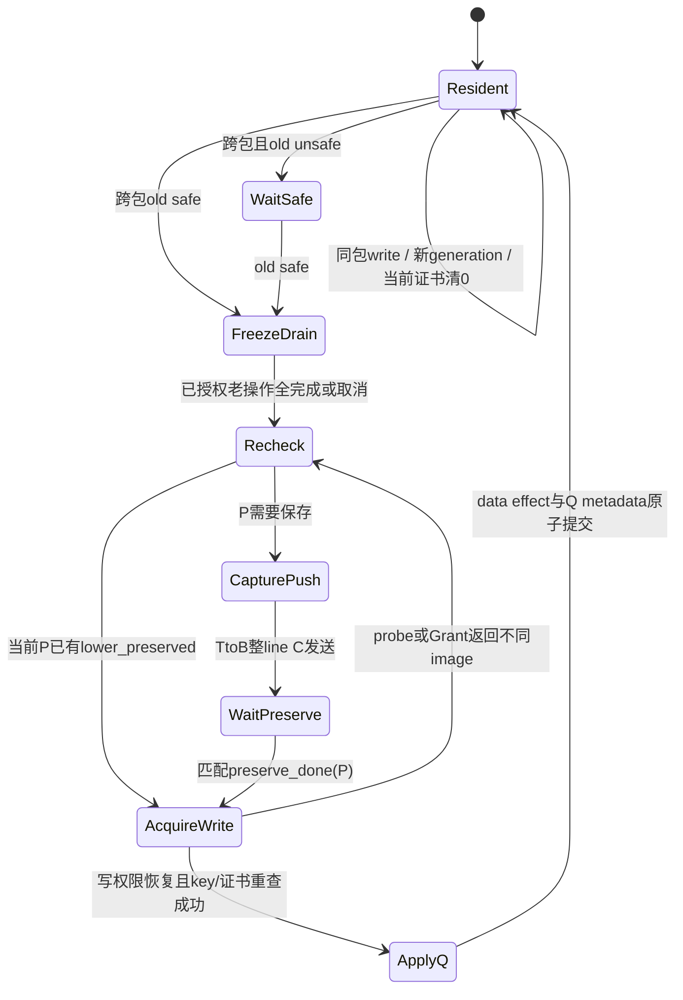
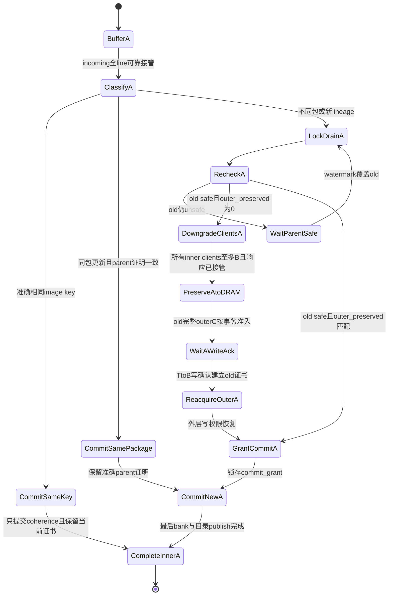
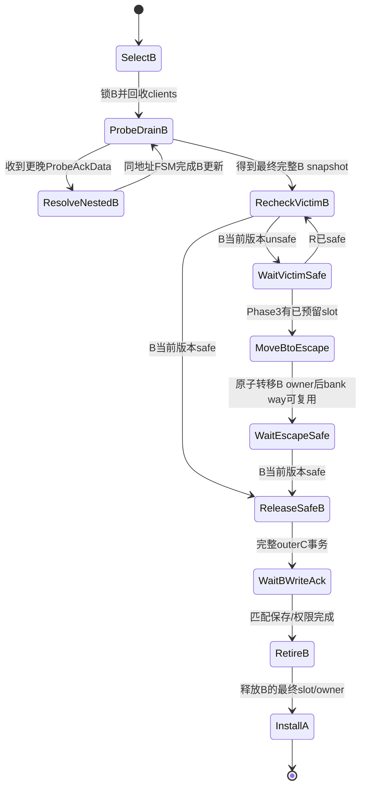

# 正常执行期间的 cache version 保存链：收敛规格（2026-10-11，revision 2）

## 1. 范围、规范性与证据

本规格覆盖正常执行中的版本保存、cache 数据正确性和协议进度。采用**单 resident image + 统一版本 invariant + transaction owner + 有序 preservation completion**；不增加每条 line 的永久多版本 data array。不实现 package FAIL rollback、新 execution epoch 或架构 checkpoint 恢复。FAIL/UNKNOWN/timeout 不构成 unsafe data 的放行条件。

本轮只更新设计资料：未修改正式 RTL、软件或 generated RTL，未编译、elaboration 或仿真。新增字段、FSM 与接口均为拟议规格；现有运行仅证明缺口，不证明本方案已经工作。source/run 身份、FST 时间换算和窄证据见 [gap analysis](cache_recovery_gap_analysis_20261011.md) 及其 manifest；不引入另一份运行作为证据。

本版取代初版的四项含糊定义：

1. `lower_equal / outer_equal` 改为 `lower_preserved / outer_preserved`，证明准确 image 的可恢复保存，不查询下一层是否仍 resident。
2. 同地址 predecessor preservation 与异地址 set victim eviction 分成两套 FSM/descriptor，不再使用泛化 `SaveOld`。
3. validation 不清版本身份；普通跨包 handoff 不执行“清 seq → 重建 seq”，在实际修改时原子切换 P→Q。
4. C/D provenance、接收准入和外层 barrier 按完整 transaction 锁存；后续 beat 不重新选择版本或安全判断。

下文“必须”是实施约束；资源尺寸和明确列出的未决项不属于已证明结论。Phase 1 的局部正确性与 Phase 2 的完整 preservation invariant 分开验收，不用早 ACK 或 UNKNOWN→BASE 伪造证书。

| 已证实缺口 | 原运行证据（接受沿，除特别注明） | 本版落点 |
|---|---|---|
| clear 后 stale hit store 被旧 refill 丢失 | clear 432471 → store 432475 → refill 432527 | slot owner、write grant、drain、完整 install |
| old 已 safe 就直接跨包写 | 0x8005a208，433887 | `safe(old) && lower_preserved(old.key)` 双条件 |
| replay 绕过，混合 111→112→111 | 2034569/2034571/2034573 | 同一 write admission；RPQ 到 effect_done 才 pop |
| L2 seq4 被 seq6 覆盖，未保存 seq4 | 0x80035e00，480795；0..480825 无同址 outer C | 同地址 predecessor FSM |
| 普通 ReleaseAck 早于完整 bank 写入 | settled 432461 输出 ACK；最后 bank 接受 432479 | 独立晚 ACK queue；实际 commit_done |

## 2. 身份、generation 与安全语义

```text
ImageKey K = {physical_line_address, content_kind, content_seq, generation}
generation = {writer_id, image_serial}
SlotOwnerKey = {bank/cache, set, way_or_buffer_id, slot_epoch}
parent_key = 上一个 package 切换前的完整 safe image 的 ImageKey
safe(K) = known BASE || (OWNED && K.content_seq <= functional_safe)
```

- `request_seq` 是请求的 package；`content_seq` 是完整 data image 的修改归属。load、MSHR load 合并、max request_seq、统计窗口均不能改变 content identity。
- `BASE` 是由已确认的安全 DRAM refill/初始化建立的 anchor。seq0 本身不是 BASE 的证明。`OWNED(P)` 必须 P 非零；`UNKNOWN` 不能建立/消费 preservation certificate。
- `generation` 标识**准确 image**，不是只在换 tag 时变化。每次实际 store、成功 SC、AMO、replay write，即使同包或写回相同 bits，都生成新 generation；同包 content_seq 不变。纯搬移/完整 refill 继承被搬移 image 的 generation。
- `image_serial` 由修改者的功能计数器分配，`writer_id` 区分 producer；逻辑上是不可回绕的 opaque token。实现可以按已证明的最大在途生命周期选 32 位或更宽的字段，若将要回绕就停止新修改并报错；不能静默 wrap。保护模式期间统计 RESET 不复位它。不同层的本地计数值不能被当作同一个 generation。
- `slot_epoch` 是另一个本地字段：invalidate、换 tag、buffer/way 重新分配时递增，检查 stale pipeline 请求。image generation 与 slot_epoch 不得复用同一个计数器。只有旧引用全部 drain 才可重新分配 slot；迟到响应还须核对 txn/token。
- DRAM 暂不存历史 package metadata：普通no-hit refill在无在途冲突且得到完整已确认 DRAM image 时，L2 创建新的 known-safe BASE anchor。不能把它伪称为旧 P 的 generation；inclusive eviction 前旧客户端必须完成 probe/ownership 回收，旧证书不得被嫁接到这个新 anchor。保存P后的permission-only升级不改image；若合法退到N后重读，仍持有匹配保存事务的owner才能凭有序确认重新关联P，否则按新BASE处理并重查incoming parent。
- `parent_key` 必须包括 parent generation，不能仅存 parent_seq。P 多次写的中间 image 不是最终 P 的替代。package 编号不要求相邻；P-1 表示该地址前一安全版本，不一定数值相差1。
- validation 只推进连续 functional watermark。它不改 data、content_seq、generation、parent_key 或 coherence，也不自动建立 preservation certificate。

同包中间 image 可以被新 image 替代；跨包切换必须保存完整旧 image。P safe 也不证明所有 P store 已物理完成：还须通过 STQ/MSHR completion 与 line drain 保证 Q 不抢在较老 P 修改前执行。

## 3. 最终 resident metadata 与瞬态 descriptor

### 3.1 L1 resident / MSHR provisional image

| 字段 | 定义与约束 |
|---|---|
| tag / coh / valid | 原 coherence metadata；valid 与版本身份分离 |
| `content_kind, content_seq, generation` | 当前准确完整 image 的身份；替代 dirtyPacketTracked/Seq 作为功能身份，不取最大 seq |
| `parent_valid, parent_key (parent_seq = parent_key.content_seq)` | 本版本开始时的 safe predecessor；BASE 可无 parent；同包修改不换 parent。实现仍可保留单独 `parent_seq` 供现有路径使用，但必须与完整 parent generation 一起比较 |
| `lower_preserved` | 当前 K 已被更低层不可撤销接管并在 L2/DRAM 保存链中保持可恢复；隐式绑定当前 K |
| `parent_lower_preserved` | 当前版本所需 parent 已在下层保存；绑定当前 content_seq、准确 parent_key；同包改变 generation 时仅可合法继承并重绑定 |
| `slot_epoch` | stale lookup/write/install 防护，与 ImageKey 独立 |

`parent_lower_preserved` 可用单 bit 实现，因为 parent_key 和当前 key 与它同一条 metadata 原子更新；ACK descriptor 必须存显式 subject key，不能凭一个地址/seq 设置该 bit。parent 证明与当前 image 的 lower_preserved 不可合并。

### 3.2 L2 resident / escape image

| 字段 | 定义与约束 |
|---|---|
| tag / state / clients / dirty / valid | 复用 Directory coherence；dirty 不等于 unsafe，也不等于 unpreserved |
| `content_kind, content_seq, generation` | resident bank 的 ImageKey，不能从 Acquire 的 request_seq 推导 |
| `parent_valid, parent_key (parent_seq = parent_key.content_seq)` | 当前版本的 predecessor；`parent_seq` 不能脱离 parent generation 单独授权 |
| `outer_preserved` | 当前 K 的准确完整 image 已在 DRAM 得到有序写确认或完整安全读入；隐式绑定 K |
| `parent_outer_preserved` | 当前 speculative K 所需准确 parent 已在 DRAM 保存；原 parent_in_dram 改为这个明确名称 |
| `slot_epoch` | bank/escape owner 的本地生命周期 |

speculative L2 resident 必须有 parent_outer_preserved；但它的 outer_preserved 通常为0，因为自己尚不能进 DRAM。P validated 后，也不能用“P 的 parent 已保存”代替“当前完整 P 已保存”。

### 3.3 瞬态 owner，不给每条 line 增加大 FSM

复用 MSHR/WB/prober descriptor，加一个 L1 version coordinator 单槽；L2 在 C put-list 旁保存 pending descriptor。至少记录：

```text
{txn_id, reason, request/STQ/RPQ token, line_addr,
 old_key, incoming_key, parent_key,
 source, sink/probe_parent_id, opcode, param, size,
 slot_owner_key, phase, beat_count,
 capture_done, all_received, data_commit_done, dir_commit_done,
 permission_done, preservation_done, completion_sent}
```

L2 `reason` 明确为 `SameAddrPredecessor`、`SetVictim`、`RefillInstall` 或 `SamePackageUpdate`。同一逻辑请求若同时要迁移 victim B 和安装 A，使用不同 key/阶段，绝不把 B 的 seq 或 certificate 用于 A。

当前证书的物理实现可只存一bit：其subject就是同条resident metadata中的完整ImageKey，任何identity写都按本文原子更新/清除它。descriptor/ACK存显式key，验证时必须比较全部字段；不能为了省bit只比较seq。完整parent地址与当前line地址相同，可省掉重复地址字段，但parent_kind/seq/generation不可省成一个模糊安全bit。

### 3.4 证书事实与本地附着

`PreservationCertificate = {subject ImageKey, boundary, completion_txn}` 是一个带 subject 的协议事实；resident 上的 `lower_preserved/outer_preserved` 只是该事实当前附着在某个 owner 上的缓存 bit。版本 K 从 L1 有序移动到 L2、再从 L2 有序移动到 DRAM 时，事实对同一个 K **单调保留**，不会因为层次变化自动失效。下层完成 `preserve_done(K,txn)` 后，上层可释放自己的数据 buffer；只要后续 holder 仍把 K 作为同一个 subject，证书可继续被引用。

若下层还没有完成 K 的下一步保存，却准备修改、丢弃、覆盖或清除唯一的 K，则下层必须先完成保存或保留 K 的受保护 owner；不能只清本层 bit 而让上层继续相信证书。协议错误、身份不匹配或 preserve 失败时，证书不能静默失效后继续运行，必须重查并 stall/fail-closed。证书被 P→Q handoff **消费**时，是把 P 的事实绑定为 Q 的 `parent_*`，不是把历史事实改写成 Q 的 current certificate。待后续 recovery cut 不再需要 P 后，P 的 record 才可退休；这属于后续 rollback/生命周期管理，不由 validation 的单拍 clear 触发。

## 4. preservation certificate 的建立、失效、消费与存续

### 4.1 证书的承诺

证书证明准确 K 的**完整 bytes**已在指定边界以下获得可恢复保存，且其有效恢复义务没有被无序破坏。它不是“曾经发送过”的历史 bit，也不是“下一层当前 tag 命中”。

- L1 lower_preserved 的位置可以从 L2 resident 迁移到受保护 buffer/escape，再在 safe 后迁移到 DRAM；有序迁移不使证书事实失效。
- L2 outer_preserved 指向 DRAM 的完整安全 image；把它从 L2 失效不撤销已经完成的保存事实，但 slot 上的附着 bit 不能再用于另一个 resident image。
- 在证书被消费/holder 改写或失效前，下层不能无序丢弃所承诺的 image。正常 inclusive coherence + 同地址版本 FSM 承担这个约束，第一版不另加 per-line 引用计数。
- 单版本 DRAM 不永久保留所有历史版本。允许在所有相关 owner 完成 handoff、旧 recovery cut 已被更晚 validated 版本取代后保存新的 safe frontier；旧证书随其 holder/义务退休，不能拿历史 bit 给更晚 image 授权。
- parent 的实时恢复义务为 `parent_required = OWNED && content_seq > functional_safe`。watermark 覆盖当前版本后可退休这一旧 parent 义务，但**metadata 不因此清零**；留下的 parent bit 是已退休关联，不再代表永久保留旧历史。在仍 unsafe 的 successor 存在时，其 parent 不得提前回收。

### 4.2 生命周期表

| certificate | 建立事件 | 失效事件 | 消费条件 / 动作 |
|---|---|---|---|
| **L1 lower_preserved(K)** | 完整 Grant 安全捕获且完整 install commit，并有 L2 对该返回 image 的保存承诺；或匹配 `preserve_done(K,txn)`。普通“收到 Grant”但未锁存 resident identity/保存承诺不建立证书 | 任何实际本地修改产生 K'；不同 K refill；invalidate/slot 退休；错误或身份不明。迟到 ACK 不得恢复旧 bit | P→Q 前，P safe、K 匹配、老写 drain；复制 K 到 Q.parent_key、建立 parent_lower_preserved，Q.lower_preserved=0 |
| **L2 outer_preserved(K)** | 完整安全 DRAM refill；或完整 outer ReleaseData 发送完且匹配内存写确认/ReleaseAck，owner 中 K 未变 | 任一不同准确 image 的 inner data commit/AMO/Put/refill；slot 退休；错误。相同 key 的合法重复搬移不失效 | 同地址 P→Q 前，P safe且证书匹配；将 K 作为 Q.parent_key，Q.parent_outer_preserved=1、Q.outer_preserved=0。victim B 可按原 coherence 条件使用当前保存证明，不能用 B.parent 证明释放 B |
| **L1 parent_lower_preserved(subject,parent)** | P→Q 原子切换消费 P.lower_preserved；或完整 Grant 携带有效 parent 链 | 换 parent/新 package 切换时先撤销旧关联；非法不同 lineage refill；丢失 owner。相同包修改仅在 parent_key 不变且义务仍受保护时继承到新 generation | 用于当前 speculative image 的 WB/provenance 校验；不能授权当前 image 的下一次跨包覆盖 |
| **L2 parent_outer_preserved(subject,parent)** | 同地址 predecessor DRAM 保存完成后提交 Q；或同包 incoming 继承已有准确 parent 证明 | 换 parent/非法 lineage/slot 退休；同包 image 更新合法重绑定 | speculative Q 安装/合并/迁移到 escape 的必要条件；不是 Q 的 outer_preserved |

`preserve_done` 必须携带 subject ImageKey + txn_id。resident key 不匹配时仅完成原 descriptor，不能给当前 line 设置证书。coordinator freeze 期间本应无 image 变化，出现不匹配应触发重查/协议错误。

### 4.3 各种修改的确定更新

```text
同包本地语义 write P,g -> P,g':
  generation=new; lower_preserved=0 (L1) / outer_preserved=0 (L2)
  parent_key unchanged; parent certificate合法继承到新subject

同包C搬移 P,g -> L2 resident P,g:
  保留发送端已经分配的同一个generation，不在接收层重新生成
  L1在匹配L2接管确认后建立lower_preserved；L2仅在已有同key DRAM证明时保留outer_preserved，普通新接收默认为0
  parent_key必须一致，parent证明合法继承
  完全相同key的重复/纯搬移可保留既有当前证书

跨包实际 write/commit P,g -> Q,g':
  require P safe && preserved(P,g) && older effects drained
  parent_key=(P,g); parent certificate=1
  content_seq=Q; generation=new/incoming generation
  current preservation certificate=0

失败SC、被nack/retry请求、load/LR、纯validation:
  不分配新generation，不改变任何image certificate

refill/搬移:
  继承返回准确image key，不伪造修改generation
  完整安装时建立适用的当前层证书和parent关联
  不能沿用被替换slot的证书；不能每beat清归属
```

AMO 的 data effect 与成功 SC 和 store 使用相同更新；replay 只决定完成回送的位置，不改变版本规则。相同 seq、不同 generation 的 full-line C 数据属于同包 image 更新，仍须核对传输顺序和 parent lineage，不得按“max seq”接受迟到旧 snapshot。

## 5. 所有修改入口：同一 invariant，不强求同一物理 gate

### 5.1 L1 write admission

```text
write_admit = original_memory_order_and_permission
           && owner_allows && slot_epoch_matches && older_effects_ordered
           && known_identity && required_parent_chain_valid
           && (same_package
               || (safe(old_key) &&
                   (known_base_anchor(old_key) || lower_preserved_matches(old_key))))
```

UNKNOWN/owned seq0 不准入；speculative OWNED image的required_parent_chain_valid必须检查有效parent关联，不能用same_package忽略丢失的parent证明。`known_base_anchor`必须来自明确DRAM/初始化记录，不能由seq0推断。未完成 token 的 new_seq<resident_seq 是排序错误，不能等新版本 safe 后再反向写旧包。已完成重复 token 只能返回完成，不能再次修改 array。失败 SC 走无写完成，不能为它触发 push。

S2 决策使用 effective metadata，包括更老 S3 实际/已授权写的 seq、generation、certificate 清除效果。若不能准确 forwarding，第一版短暂串行同 line 修改；不能按拍前 metadata 给两个冲突写同时许可。S2 write grant 携带 token、slot_epoch 和准确/已序列化 ImageKey 依赖，到 S3 实际 fire 或合法取消才耗尽；S3不能仅靠旧 s2_hit。

### 5.2 入口审计矩阵

| 入口 | 物理检查点 / owner | 必须遵守的规则 |
|---|---|---|
| `t_lsu` store、killed-store retry | S2 admission → S3 actual write | common write_admit；无许可不得 send-success/S3写 |
| `t_replay` store / SC / AMO | RPQ issue预检查 + S2相同admission + MSHR owner | forced coherence hit不能替代版本许可；保留head/payload到effect_done |
| store miss / upgrade completion | MSHR主/secondary接管 + 最终replay write | 接管不算修改；不同包secondary write不合并；最终write仍通过相同gate |
| successful SC / AMO | 包含AMO旧值读取的S2授权与S3提交 | 当前准确image/权限/owner保护到effect；失败SC无image更新 |
| L1 refill / prefetch refill | MSHR install owner | victim保存/迁移完成、旧引用drain、完整image安装后原子publish；不能覆盖成功年轻store |
| L1 probe/invalidate、replacement、WB | prober/MSHR/coordinator统一slot owner | snapshot完整、老写drain；C provenance来自snapshot，不能来自实时array；当前image不能无承诺丢失 |
| L2 ReleaseData | SinkC transaction descriptor → 同地址FSM/commit owner | staging可以先接收；resident覆盖必须先保存准确safe predecessor |
| L2 ProbeAckData / nested WB | 相同C staging与同地址规则，再通知父probe | 删除SinkC直接bank写旁路；父probe completion不早于全部data/provenance commit |
| L2 outer refill / replacement install | refill owner +独立victim FSM | A的新identity不继承B的证书；回来的旧Grant不能覆盖已提交更新 |
| L2 inner A Put/Arithmetic/Logical | SourceD实际bank修改前取得version owner | 不能因走A而绕过同址规则；支持的package修改必须有归属，trusted safe写也不能摧毁活跃spec parent |
| L2 SourceC WB / flush / escape drain | snapshot owner + transaction barrier | release当前准确image；speculative victim不能通过no-data/drop绕过边界 |
| init / cache维护 / ECC改写 | 初始化或已有owner | init仅建立明确BASE；维护按同一保存义务；仅纠正编码不改变逻辑bytes时保留ImageKey |

L1 与 L2 使用不同的执行 gate，但 invariant 一致。所有 dataWriteArb、SinkC.bs_adr、SourceD.bs_wadr、Directory identity write 必须能追溯到 owner/commit authorization。

uncacheable MMIO 不纳入本cache保存链；**可缓存受保护DRAM的uncached A写**不能借此豁免。checker scratch/PTW/管理写需要明确地址域/可信来源；尚未证明合法的入口在完整保护启用前须路由到同一规则或拒绝，不能默认seq0安全。这些客户端分类不阻碍Phase1的本地pipeline修复，但阻碍Phase2宣称全路径覆盖。

## 6. L1 version state machine：保留P身份，实际apply时切到Q



- **WaitSafe：** 持有等待意图，不占WB/data arb，不禁止必要旧P与probe进度。真正冻结前重新lookup，不能用旧set/way盲发WB。
- **FreezeDrain：** 在owner获取时拒绝新冲突操作；已经获得write grant的较老操作先完成。按live token/fire计drain，不插固定等待拍。S1/S2旧lookup必须nack/取消并保持请求可重试。
- **Recheck：** 确认最终P key/权限/证书。P已经safe也必须检查preservation。未拿到coordinator槽的新请求nack/stall，不能覆盖descriptor。
- **CapturePush：** 复用WB snapshot，禁止边捕获边修改。对有T权限的正常handoff，使用合法 `ReleaseData(TtoB)`，在coherence规定的释放点降为B，保持P完整data与identity；它是权限downgrade，不是version Clear。
- **WaitPreserve：** 等L2全data+目录提交后的匹配晚ReleaseAck。snapshot/capture_done、最后C接受、WB idle均不是preservation完成。WB buffer在最后C可靠接管后可服务其他probe，pending ACK descriptor独立保留。
- **AcquireWrite：** 无T时复用现有MSHR `AcquireBlock(BtoT)`（当前代码未优化AcquirePerm）。GrantData若返回P，完整接收后保持P、验证lower_preserved并恢复写权限；无data Grant则仅完成permission，不改image/generation/证书。如合法probe已使客户端变N，则按NtoT重新获取。不能假装TtoB后仍有T。
- **ApplyQ：** Q在实际dataWrite fire时才分配新generation、将准确P key转为parent、更新证书。coh SRAM与功能metadata若不同拍写，owner持续到全部提交，effective metadata forwarding/对外publish保证原子可见性；不能提前放行普通LSU。

不同包请求通常留在STQ并nack重试；coordinator不提前宣告Q完成。已有lower_preserved且写权限充足的路径可直接授权ApplyQ。fresh Grant证书避免 `push P→reacquire P→再次push P` 循环。

probe必须保持进度：WaitSafe允许probe先服务；freeze后同line probe与coordinator合并/委托一个owner，不产生两个修改FSM。若释放/升级期间probe强制toN，保留descriptor中的P身份、合法服务probe，resident置invalid并转重新lookup；旧ACK不能给另一个image授证。第一版不增加新的preserve-only TL opcode，也不使用非法TtoT ReleaseData。

## 7. Clear、validation与handoff的精确定义

**删除正常version FSM中的Clear状态。** 不定义“validation clear”。现有清除路径分成以下事件：

| 事件 | 可以清/改什么 | 必须保留什么 / 完成条件 |
|---|---|---|
| package validation | 仅更新functional bitmap/watermark，退休已满足的旧recovery义务 | data、content_seq/generation、parent_key、当前image保存证书、owner全部不变 |
| TtoB preservation push | coherence权限降为B、请求瞬态进度 | P完整identity/data；匹配完成建立P.lower_preserved，不把seq清0 |
| 真正invalidate / TtoN / replacement | resident valid/coh失效、reservation；slot上证书不再可用 | 原key/provenance在WB/probe/transaction descriptor保留到接管完成；旧引用drain后slot_epoch更新，不能将stale hit视为有效 |
| P→Q handoff | 实际修改时content_seq=Q、generation新值、parent_key=P完整key、current certificate=0、parent certificate=1 | P不经UNKNOWN/seq0中间状态；不修改valid/tag；coherence权限必须合法 |
| txn退休/队列slot释放 | 已完成descriptor的pending/beat/token/owner valid | 仅在对应completion被接收、无live引用后；不清其它resident版本或功能水位 |

invalidate后旧metadata bits可保留为无效tombstone；不能由它们重新命中。换tag/install时由新owner一次完整发布，不能依赖先清seq再逐beat重新污染。Phase1仍需修当前shadow TtoN的invalidate hazard；Phase2正常handoff将其替换为上述TtoB流程，TtoN保留用于真实eviction/probe。

## 8. replay、store顺序与refill生命周期

```text
RPQ head → issue(保留head/SDQ) → replay_inflight
         → APPLIED / LOAD_RESP / NO_WRITE_SC / CANCEL_PRE_EFFECT
         → matching effect_done → RPQ pop + SDQ free
         → RETRY则只清inflight、保留head/payload，不pop
```

每个MSHR最多一个inflight replay；completion含MSHR id、allocation/token、slot_epoch及ImageKey依赖。已产生effect不能因branch/exception被当成未执行取消。AMO completion须保证实际write与其响应均被正确接管。直接从LineBuffer响应的load在真实response接收后出队；它不建立store完成。

保守初版排序：MSHR write domain只含一个package；不同包secondary write退回STQ。store miss/upgrade被接管后，年轻store暂不issue，直到较老token实际完成；load照常按原memory-order执行。同包hit无需等validation，但不能与snapshot/install owner并发修改。

新增功能 `store_apply_done` 对所有相关cacheable store生效，携带STQ allocation token，不依赖measurement enable。普通MSHR accepted响应只表示接管，STQ不能因统计token不存在而释放；功能token与既有strict traffic token分开或将其功能生命周期完整解耦。

refill只由install owner修改way。返回image先在LineBuffer完整接收，provenance first beat锁存；安装期间禁止外部hit，最后data实际写完才提交provisional identity/certificate。replay应用后再更新最终identity。RPQ为空**且inflight为空且最后write grant耗尽**，才publish最终metadata/释放owner。

GrantAck(E)在完整Grant被可靠捕获并能履行协议时发送，不等待本地watermark/replay排空。提前E不意味着提前暴露line；期间probe必须能由MSHR owner服务或获得有界暂存。

## 9. transaction-level provenance/admission/barrier

### 9.1 first/last与锁存字段

transaction开始指发送端冻结snapshot、建立descriptor，接收端则以**first beat fire**正式接管。sender在first valid但ready0时也必须保持header/data稳定；不能等fire后才把实时array身份冻结。

C first fire锁存：`{txn_id/source lifecycle, opcode,param,size,line_addr,content_kind,content_seq,generation,parent_valid,parent_key,parent_certificate_claim,receiver_buffer_id,probe_parent_id}`。receiver_buffer_id/probe_parent_id是接收端descriptor字段，不必在wire上重复传。C后续beat必须匹配所有fixed wire字段；只允许data/corrupt/beat变化。beat计数以fire递增，不能按valid递增。parent claim须结合本地保存记录与lineage验证，不能仅信任sender的一个bit。corrupt/denied不产生假preserve_done。

txn_id可以是`{source,本地source allocation epoch}`，不必另加全局事务号。ReleaseAck按现有source映射唯一pending descriptor，再取该descriptor的ImageKey；同source新voluntary Release须等旧ACK退休。ProbeAck没有ACK，绑定已发probe的父owner/client和本地序号，完整接管前不得重用该响应身份。generation用来核对image一致性；不同writer的serial不能作全局大小排序，C提交年龄依赖coherence接管次序与owner token。

D Grant first fire同样锁存**返回resident image**的身份、parent及保存承诺，并核对后续beat；不得echo Acquire request_seq替代data身份。推荐使用当前TL的C requestFields、D responseFields，经过buffer/crossing保留；sideband替代必须transaction-bound、held-valid/ACK/容量反压，禁止地址CAM取最大seq。

### 9.2 两种准入，均按完整事务

1. **Transport admission：** SinkC在first fire前预留整line staging容量、descriptor与必要完成额度。一旦接管，无论中途watermark如何变化，都用锁存身份接收全部beats；禁止中途改成另一个seq或因版本gate停止接收最后beats。物理backpressure仍允许，但必须已预留可完成资源。
2. **Resident commit admission：** 收完或已能可靠冻结完整incoming后，取得同地址owner，检查准确old/new key与certificate。允许时锁存`commit_grant(txn,old_key,new_key,slot_epoch,parent_proof)`；从第一个bank写到最后bank/目录publish都使用同一grant，禁止每beat重新判断版本。等待期间发生合法resident变化时，在grant前重新检查；grant后冻结resident或明确委托owner，不能偷换metadata。

收到C不等于“speculative image已成为L2 resident”；staging是有owner的pending image，旧predecessor仍受保护。普通同址read/Acquire不得在pending Q之后读旧P；第一版排队到Q提交，不能用返回旧值避免stall。

### 9.3 外层barrier的唯一安全决定

普通victim、同址predecessor保存、escape drain共用：

```text
outer_txn_eligible(K) = known BASE || (OWNED && K.seq <= l2_functional_safe)
```

在**最终选择的准确snapshot transaction**进入SourceC正式发送队列时检查并锁存 `{txn_id,K,allowed,safe_at_admit}`；若队列尚未接管、snapshot/key被合法改变，则新事务必须重新准入。到first C fire断言该锁存授权与事务一致，包括原barrier release拍。不是每beat重新读directory/水位。

一旦事务被准入/first valid发出，header、snapshot与allowed固定，watermark上升不改变它；完成后释放。unsafe候选保持park，不占正式发送队列头，不能发半条再等待safe。已启动safe事务必须收完，不能因另一条barrier而中途撤valid。global barrierReleased不得授权不同key/seq。

close ACK只是受理，不是PASS。复用同一个close/watermark服务，不新增第二套安全水位。safe/control/必要响应仍可调度；no-data Release也不能用来丢弃唯一unsafe image，其owner迁移/保存义务必须已经满足。

### 9.4 ownership释放点

| owner | 释放条件 |
|---|---|
| sender的snapshot数据buffer | 最后C被可靠接收；若需本地retry/错误处理仍引用，则继续保留；释放buffer不释放pending ACK身份 |
| voluntary Release txn/source descriptor | 全数据可靠接管、匹配晚ReleaseAck被接收、coherence完成，无残留引用 |
| receiver C staging data | 全部data实际bank commit，或准确相同key的重复数据已逐beat核对/合法丢弃，或原子迁移给另一个受保护owner；仅ACK发送完不能代替data消费 |
| receiver logical txn | 全C收到、数据commit/合法same-key no-op完成、dir publish、权限完成，且ReleaseAck被接收或Probe parent commit_done被接管 |
| outer victim/preservation txn | 全outer data发送、匹配写确认、目录/权限后处理与owner移交完成 |

## 10. L2同地址 predecessor preservation FSM（A地址）

场景为 `A(K_old safe) → A(K_new speculative)`；old与incoming都是A。**保存的是A当前准确old image，不是另一条victim，不是old的parent。**



- `ClassifyA`：准确相同key为重复/纯搬移，可保留outer证书；完整bytes必须相同，模块scoreboard/断言验证，不能只看key就吞掉错误payload。same-key可重写相同bytes或有序消费后no-op，并发回data_commit_done，不虚构最后bank fire。同包较新image按coherence transaction顺序允许覆盖中间image，但必须parent_key一致且当前spec parent_outer_preserved有效。迟到旧generation/不一致lineage不取max，视为协议错误或已完成重复。
- 不同包incoming的parent_key必须与被保存的old_key吻合，或由持有完整证明的合法owner给出明确迁移关系；不能仅parent_seq相等就认可。ordinary Release no-hit违反inclusive expectation；不能凭C arrival新allocate后把parent丢掉。
- `WaitParentSafe` park在put descriptor，只pin准确A，不占SourceD或永久堵整set。合法版本变化要求重查；版本许可没有锁存前不能写A bank。
- `DowngradeClientsA`确保outer降至B前，所有inner clients至多B，且必要ProbeAck完整接管；不能保留inner T却把outer降为B。voluntary TtoB sender已降B，不必额外invalidating它；ProbeAckData(TtoT)保留的写权限则必须先回收。nested data更新使用独立staging owner并保持事务顺序，不能重写被冻结的old predecessor；必要响应额度不能被等待的Release耗尽。
- `PreserveAtoDRAM`仅发safe A。本last-level配置采用SourceC `ReleaseData(TtoB)`和SinkD/内存写确认，完整old image有outer_preserved后做outer `AcquireBlock(BtoT)`恢复T，再提交incoming。SourceC已有param字段，修改的是同址保存计划，正常victim仍TtoN/BtoN。这样inner B可以保留，不需要为保存前驱额外制造正常handoff的invalidate/clear。
- 当前`Parameters.scala:155–156`要求lastLevel，`TLCacheCork`将ReleaseData转PutFullData、AccessAck转ReleaseAck（约91–105/158）；其BtoT Acquire直接生成无data Grant（约68–89）。因此外层升级继续保留bank中的old image/key，不能等待不存在的GrantData或做空refill。L1升级也须分别处理Grant与GrantData。该方案不扩展到有outer probes的多级coherent parent；后续扩展须另审权限/暂存规则。
- outer TtoB保存确认后，resident权限记B、已保存old的dirty可清；BtoT完成后再记T。incoming实际提交才把新image标dirty。权限变化不能顺带改content_seq/generation或将old cert置为新的incoming cert。
- 明确新增`same_addr_preserve_mode`：旧A保存的source/address/key和incoming A提交计划分开；保留resident descriptor，不使用普通eviction的INVALID目录计划。SourceA grow参数按BtoT设置，不能继续默认NtoT。若合法coherence活动改变身份/权限，重查并按准确状态处理；不得把s_release=false当成复制数据按钮，也不得TtoB后继续假装有T。
- `CommitNewA`锁住resident，完整data写入后原子publish新key。不同包设outer_preserved=0、parent_key=old_key、parent_outer_preserved=1；同包不同generation继承incoming的原parent_key与已存在证明，不把中间同包old image当成新parent。准确相同key的合法搬移保留当前证书。都不能因bank写入再生成一个与C不同的generation。
- ReleaseData晚ACK独立于SourceD写流水线；ProbeAckData没有D ACK，直到commit_done才更新父MSHR `w_pprobeacklast/w_rprobeacklast`等真正完成标志。不能卡SourceD首拍等最后bank写，这会自锁。

**同地址 invariant：** `commit_new_A(Q!=P) -> safe(K_P) && DRAM_preserved(K_P)`；P的准确generation与Q.parent必须匹配。对speculative同包更新，则要求准确parent证明保持有效。A的cert从来不能证明B已保存。

## 11. L2 set replacement victim FSM（B地址）

场景为新line A需要way，原way是**另一地址**B(R)。B的parent已经在DRAM，不代表B本身已保存；B unsafe时不能因为A ready或B.parent_outer_preserved=1就释放B。



- 最终victim identity要在必要probes/nested data commit之后确定。目录可能仍记safe P，而client已写spec R；不能用probe前的safe资格放行probe后的R。
- `ResolveNestedB`调用B自己的同地址FSM：若incoming R覆盖B中safe P，先保存P，再提交R。之后replacement检查R，仍须等R safe才能写DRAM。
- `WaitVictimSafe`复用现有barrier/close，保留B完整image，不占正式SourceC发送队列；等待水位推进后对最终snapshot重新准入。
- 无escape时，B仍占bank way，A不能install。Phase3有预留escape时可在未safe时迁移完整B并释放**bank way**；B的escape slot/image owner仍保留，R safe、完整outer保存确认后才释放。不能把way free当作victim保存完成。
- `ReleaseSafeB`按照真实coherence param与dirty状态使用现有Release[Data]，必须保存当前B，而非其parent。已有准确outer_preserved只有在合法无data/coherence释放且没有唯一image丢失时才可避免重复写；保守实现可对dirty safe B仍发送完整data。
- `InstallA`建立A自己的identity与证书，不能继承B/R/parent字段。若escape提前腾way，A installation与B escape drain是独立owner，不等同B退休。

**victim invariant：** `outer_B_data_first_fire -> safe(B.current_key)`；`retire_B_final_slot -> current_B_preserved && coherence_complete && no_live_refs`。`move_B_to_escape`不是outer写、不解除barrier，也不允许丢弃B。

## 12. 进度约束与复用barrier

复用已有functional连续PASS水位、CDC、BOOM/R_IC close服务和SourceC/SinkD。measurement START/STOP/RESET只影响统计，不能清owner、generation、functional result bitmap/safe或修改请求身份。

必需资源规则：

- WaitSafe不占WB；最后C接管后WB data buffer与唯一voluntary-release pending ACK descriptor分离，使probe可用。
- C staging至少保留必要ProbeAck响应容量；未完成自愿Release不能耗尽所有response额度。
- version-wait park不占SourceD，不把整set永久锁死；同址锁/合法嵌套coherence按owner委托，不给两个FSM修改权。
- ACK独立queue held-valid；SourceD持续完成全部data beat，再产生一次completion。D/E/已发probe响应与old owner drain优先于新请求，并有有界公平。
- safe predecessor、safe victim和控制/完成消息可调度，unsafe候选不能用global allow0堵住它们。

仍有结构性反例：active P的unsafe victim占way → ROB中P load miss不能完成 → ROB不能empty → 当前close不能封P → safe不能覆盖P。这是源码依赖反例，非本轮新增运行死锁证据。

Phase3采用边界内有界escape + drain credits +提前pressure-close，给已admit且阻碍封口的load/AMO/fence/PTW等预留完成资源。停止新dispatch/prefetch/竞争请求；ordinary committed store可保留STQ owner等待，不能简单要求全STQ/MSHR empty才能封口。escape必须参与lookup/probe，不能从DRAM给同址返回旧parent。

容量按已admit必要操作、stop/CDC延迟、跨line/PTW、checker及coherence依赖闭包推导。初版曾提出Sv39候选K=8、每bank E=16个64B slot，**本版明确不将其作为冻结参数或死锁证明**；须核对实际配置及压力测试。不得同一buffer同时计为响应保留和escape容量；timeout无unsafe旁路。该未决资源尺寸不阻碍Phase1，但Phase3通过前不宣称整机任意压力下可前进。

## 13. 必须实现的 invariant / 最小 assertion

```text
write_effect -> matching live write_grant(token, slot_epoch, image_dependency)
invalidate_or_install_publish -> old grants/references drained
replay_pop || SDQ_free -> matching terminal effect_done (RETRY不算terminal)
local_semantic_modify -> new_generation && current_preserved'=0
incoming_image_commit -> key'=incoming.key && certificate_rules_match_classification
validation -> image_key/parent/current_cert unchanged
L1_apply_Q_different_package -> old_safe && (known_base_anchor(exact_old_key) || lower_preserved(exact_old_key))
L2_commit_A_different_package -> old_safe && outer_preserved(exact_old_A_key)
L2_spec_commit_or_escape_move -> parent_outer_preserved(exact_parent_key)
outer_C_first_fire -> txn.allowed && key_matches && safe_at_admit
C/D_following_beat_fire -> fixed_header/provenance_matches_first
preserve_done_set_cert -> ack.txn/key matches current protected descriptor
lateReleaseAck -> all_C_received && data_commit_or_validated_noop_done && dir_published && permissions_ready
retire_victim_slot -> current_victim_preserved && no_live_refs
measurement_reset -> functional_watermark/owner/generation/token unchanged
```

certificate跟generation绑定的assert与data scoreboard都必须有：记录BASE/P/Q完整image与byte mask、每个STQ/replay token、保存确认key。版本assert不能替代bytes比较。同包中间image覆盖、P最终image、L2 parent与异址victim各用独立scoreboard条目。

## 14. 主要RTL位置及复用/合并

B=`chipyard/generators/boom/src/main/scala`；L2=`chipyard/generators/sifive-cache/design/craft/inclusivecache/src`。行号按当前源码，仅作入口，不能代替提交时的重新定位。

| 模块 / 文件 | 实施职责 |
|---|---|
| B/lsu/dcache.scala，BoomNonBlockingDCache | owner/interlock：s1_nack约695、S2 hit/nack约732/809、shadow pending/clear约1027–1108；S3 grant/fire与refill约1515–1603；准确identity、cert、统一predicate与coordinator |
| 同文件BoomWritebackUnit/BoomProbeUnit | full snapshot owner；capture/send/preserve_done分离；TtoB handoff，TtoN真实eviction；pending ACK与probe buffer解耦 |
| B/lsu/mshrs.scala，BoomMSHR/File | secondary write domain约172–179；refill/安装/replay约289–367；RPQ issue pop约345、SDQ free约782；inflight/done、Grant身份/早E |
| B/lsu/lsu.scala | 功能STQ allocation/effect token；约2084清STQ条件从traffic token解耦；miss accepted与apply完成区分；较老miss store阻止年轻store |
| B/exu/core.scala；rocket-chip/.../r/R_IC.scala | snapshot尾部functional package归属；现有close入口复用；Phase3 pressure-close/drain credit，不接FAIL rollback |
| L2/Directory.scala、MSHR.scala | ImageKey/cert/parent；分离same_addr_preserve_mode与set_victim_mode；dir publish、权限重获、probe parent completion |
| L2/SinkC.scala | first-fire锁header与buffer额度；ReleaseData/ProbeAckData统一staging；移除约110–139的ProbeAckData直写bank旁路 |
| L2/SourceD.scala、Scheduler.scala | last真实bank fire的commit_done；独立晚ACK arb/queue；park/final-selected事务准入；不用first-beat ACK等待last写 |
| L2/SourceC.scala、SourceA.scala、SinkD.scala、InclusiveCache.scala | transaction snapshot/allowed锁存；旧A的TtoB保存/BtoT升级与B的TtoN eviction复用外层C/ACK/Acquire；单barrier；Phase3 escape数据源 |
| rocket-chip tilelink/Bundles.scala及节点/Tile参数 | C requestFields / D responseFields传ImageKey/parent/保存承诺；buffer/crossing字段协商 |

复用data/tag arrays、WB、LineBuffer、RPQ/SDQ、coherence权限机、Release/Acquire/Grant/E、SourceC queue、continuous watermark和close CDC。删除/合并功能用途：LSU-only版本gate、零散pending bool拼接、validation/统计reset清功能状态、每beat清seq、MSHR max seq推断data身份、RPQ issue即pop/free、ProbeAckData直写、早ACK冒充preserve_done、地址CAM决定功能provenance、global released通行。

## 15. Phase 1 / 2 / 3 的最终边界与验收

| phase | 冻结范围 | 验收与关键波形 |
|---|---|---|
| **Phase1：局部ownership、ordering与effect completion** | slot_epoch/write grant/owner、现有TtoN clear hazard与drain、refill全line/provisional publish、RPQ issue/inflight/done与SDQ/STQ功能完成、单package write domain与较老miss排序、准确本地image generation、统计隔离与package尾部身份 | T4 store不被旧refill覆盖；T5不再111→112→111混写；相邻hit/replay/clear/refill、S3 backpressure、SC失败/AMO、nack/取消exactly-once；RESET不改功能状态。观察S1/S2 key/epoch/grant，S3火/token，owner/drain，refill first/last/install，RPQ head/issue/inflight/done，SDQ/STQ valid |
| **Phase2：完整preservation链与transaction协议** | 本文certificate正式建立/消费；C/D身份/parent传递；L1 TtoB保存→升级→原子P→Q；L2同址predecessor FSM及独立victim FSM；ProbeAckData统一staging；晚ACK/权限重获；transaction barrier；所有受保护修改入口覆盖 | T2 safe-old先preserve；T3 seq4准确image得到DRAM写确认再提交seq6；同包更新不等safe；下层继续迁移不撤销合法证书；相同seq新generation清当前证书；延迟每个data/dir/ACK/E握手、mid-transaction水位变化与候选切换；异址B必须等自身safe。观察key/gen/parent/cert，txn owner/header/allowed，same_addr/victim phase，C/D first/last，bank/dir commit，outer ACK、late ACK |
| **Phase3：容量进度与整机收尾** | escape/progress resources、credit上界与pressure-close、公平/响应保留、checker/PTW依赖闭包、全工作负载与退出drain | active-P unsafe victim+ROB load/AMO/fence；slow checker、多bank/set压力、C/D/E反压、slot接近满；close→PASS→safe→escape drain且无unsafe escape；benchmark verified=1、实际package执行/结果一致、tohost前pending清点。观察escape occupied/reserved，必要请求credits、dispatch stop、ROB/LSQ、close ACK/result、functional_safe及所有pending |

**Phase1不声称保存链已经正确。** safe-old push、L2 predecessor保存和完整refill provenance仍由Phase2完成。Phase1实现统一local admission/结果接口并明确返回`NEED_PRESERVATION`，不把现有早ReleaseAck当作有效证书。严格certificate许可必须与Phase2完成端一起接通；若提前接通，缺少证明的请求应保留/stall，不能为跑通整机伪造cert。Phase1的局部模块验收不依赖完整保存链，Phase1中间实现不能作为最终recovery版本发布。

后续实施每phase再执行源码/Scala、elaboration/FIRRTL/组合环、定向模块、同配置整机检查；本轮只检查文档与源码路径，不执行上述检查。

## 16. Phase1可以立即着手的RTL点（本轮未修改）

按依赖顺序：

1. **功能请求身份/完成接口。** lsu.scala新增不受traffic开关影响的allocation/effect token；core.scala保持snapshot尾部所属package；STQ保留到实际done/合法无写完成，early accepted不释放。包身份修正不能只改统计打印。
2. **slot owner与pipeline授权。** dcache.scala将shadow invalidate纳入S1/S2 hazard，S2授write grant，S3按owner/epoch写；owner获取与grant仲裁，freeze→drain→metadata recheck。旧成功store不能被invalidate/refill越过。
3. **replay request保留。** mshrs.scala分开RPQ peek/issue与pop；增加inflight和带ID的done/retry，SDQ在terminal done后释放；dcache.scala去掉replay的version bypass，仍可保留MSHR提供的coherence hit。
4. **单包write domain/保守store顺序。** secondary不同包write拒绝合并；LSU在较老miss/upgrade实际done前不发年轻store；load request_seq不抬content_seq。gate不能简单在已经出队的replay S2上补nack。
5. **完整install与identity commit。** MSHR独占destination，最后data写完成才建立provisional metadata，RPQ+inflight+S3全drain再publish；删除每refill beat清seq。此阶段不以缺少D身份的refill建立假BASE/假cert，外来身份完整建立在Phase2完成。
6. **功能/统计隔离。** pending、functional watermark/result tracking、generation、effect tokens移出traffic_reset作用域；RESET仅计数。加最小owner/terminal-done/stale-write断言与bytes scoreboard钩子。

这些点可逐项审查和模块验证，但1–5的接口必须成组集成；不能只加一个S2 replay nack或把pending清零延后固定拍数。原TtoN跨包路径的锁/drain在Phase1修正，normal handoff改TtoB及preserve_done在Phase2完成。

## 17. 不阻碍Phase1、但必须在后续关闭的未决项

| 未决项 | 冻结的正确性要求 | 必须关闭的阶段 |
|---|---|---|
| TL字段的具体BundleKey/节点协商、writer_id分配与字段面积 | ImageKey/generation跨层不丢、不取max；证书与完整transaction绑定 | Phase2接通前 |
| TtoB后AcquireBlock的Grant/GrantData、nested probe、pending ACK具体资源/ID布线 | P identity不清零；outer降B前inner不得保留T；无data Grant不做refill；合法probe进度；旧ACK不污染新image | Phase2验收前 |
| outer memory确认与certificate退休的精确客户端覆盖 | 当前last-level Cork/AccessAck保存契约；所有protected域写不能绕过；既有inclusive协议足以完成旧holder退休，否则补握手 | Phase2验收前 |
| checker/PTW/uncached cacheable/A Put的trusted域与归属 | seq0不自动safe；不能返回旧P来解决pending Q依赖 | Phase2全入口覆盖、Phase3依赖闭包 |
| escape/credit/progress-way的尺寸与封口依赖上界 | 不透支已admit必要完成资源；unsafe B仅迁移，不越界/释放最终slot | Phase3进度验收前 |
| rollback epoch、FAIL后恢复和历史证书重建 | 本轮不实现；FAIL只保护/报错，禁止借timeout推进safe | 后续独立设计，不阻碍本轮Phase1–3正常执行范围 |

本版已确定certificate语义、三套FSM、transaction完成点与phase边界；尚未动态验证。旧FST用于重放反例和设定scoreboard，不用于宣称新FSM或无死锁证明通过。
