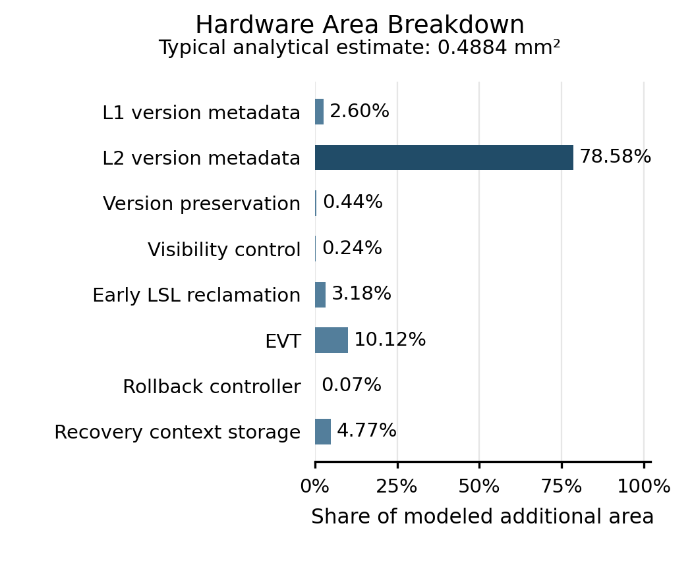

# DAC Hardware Overheads：面积估算

采用现有 r2 Typical 模型，仅核对和导出；未修改 RTL、未做集成、功能测试或新综合。

| 模块 | 估算面积（mm²） | 占总新增面积 |
|---|---:|---:|
| L1 Version Metadata | 0.012719 | 2.60% |
| L2 Version Metadata | 0.383785 | 78.58% |
| Version Preservation | 0.002146 | 0.44% |
| Visibility Control | 0.001155 | 0.24% |
| Early LSL Reclamation | 0.015513 | 3.18% |
| EVT | 0.049453 | 10.12% |
| Rollback Controller | 0.000349 | 0.07% |
| Recovery Context Storage | 0.023304 | 4.77% |
| **Total** | **0.488425** | **100.00%** |

CSV保留未显示的精度。L1/L2 Version Metadata包含对应selector与store policy；Visibility Control合并原visibility checks（0.0003374 mm²）和SW bitmap（0.0008176 mm²），无遗漏或重复。

参考归一化：`A_PEEK,ref = 3.96 + 4×0.27 = 5.04 mm²`；`0.48842495 / 5.04 × 100% = 9.69097123% ≈ 9.69%`。分母是PEEK论文的核面积参考和，不是本项目同配置系统面积，也没有在该分母额外加入共享L2。不得称为同配置、同工艺的实际综合开销。

## English paragraph

For the frozen configuration with a 1 MiB, 16-way L2 and 32-bit sequence numbers, our Typical analytical model estimates 0.4884 mm² of additional PALIMPSEST hardware. L1/L2 version metadata and its selection/store-control logic account for 81.18% of this estimate, followed by the EVT (10.12%) and recovery context storage (4.77%). Using the PEEK paper's reported BOOM area of 3.96 mm² and Rocket area of 0.27 mm² per core, the reference area for one BOOM and four Rockets is 5.04 mm²; our modeled increment is therefore 9.69% of that reference core-area sum. This percentage is a reference-normalized analytical estimate, not a synthesis comparison under matched hardware configurations and process conditions. The model combines generic logic counts with assumed SRAM and gate densities; field widths, storage sizing, macro organization, and omitted interface logic are the main sources of uncertainty.

## 估算方法与关键假设

`A = (B_RAM × 0.40 × 1.25 + GE × 0.70) / 10^6 mm²`，其中`B_RAM=818,176 bit`、`GE=113,338.5`；0.40为假设SRAM密度（μm²/bit），1.25为packing系数，0.70为假设NAND2等效面积（μm²/GE）。得到RAM项0.409088 mm²、逻辑项0.07933695 mm²，合计0.48842495 mm²。DFF已经包含在GE内，没有再按SRAM计费。未加入旧模型额外buffer和15%接口余量。

- 几何：Main L1D 32 KiB/2-way；L2 1 MiB/16-way；64 B/cache line。
- 字段假设：Seq32 + Recovery Epoch4 + CurGen8 + Cur1 + preserved1 = 46 bit/line；L1D 512行、L2 16,384行，对应777,216 bit版本元数据。该46位是模型假设，不是冻结接口完整81位image key的实测实现。
- 上下文：8×80×64=40,960 bit；EVT：16 entries、16 queries；LSL回收：每checker 8个descriptor，共4核；SW window16。这些沿用现有r2设计假设，本次不重新论证容量。
- 边界：估算的是新增元数据/控制/恢复上下文原语；既有L1/L2 Data/Tag、PEEK原有checkpoint和LSL payload未再次计入。本场景将SW和reclaim描述符作为新增项；最终复用或替换会改变净增量。
- 主要误差来自SRAM密度和端口/宏组织、GE折算、元数据位宽和context/descriptor容量，以及未计入的接口逻辑。该模型没有28 nm标准单元库或SRAM宏映射标定，不是完整系统实测面积。

## 输入与导出

- 资源与逐模块值：[module_area.csv](/data1/gzh/EC/check/area_eval/revisions/r2-20261113/results/module_area.csv)。
- Typical参数与小计：[area_summary.json](/data1/gzh/EC/check/area_eval/revisions/r2-20261113/results/area_summary.json)。
- 核面积参考：[Micro26_PEEK.txt](/data1/gzh/EC/check/area_eval/evidence/Micro26_PEEK.txt:941)。
- 图：hardware_area_breakdown.pdf / .svg / .png；表：hardware_area_breakdown.csv / .tex。
- 正文：hardware_overheads.tex / .md；图插入片段：hardware_area_figure.tex。
- 复现：在本目录执行 `python3 export.py`，仅读取现有资源结果并导出本目录文件。
