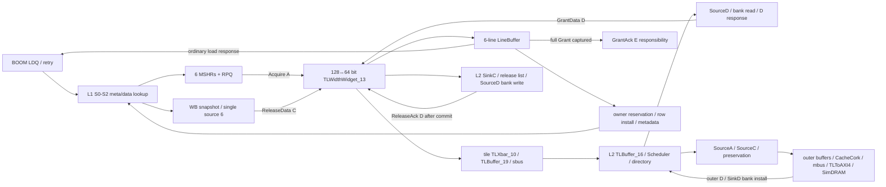

# 实际 cache transfer path

来源：`source_evidence.json` 保存源码逐行摘录、SHA256 和本次读取的已生成模型连接。源码根为 `chipyard/generators/`。当前未重新 elaboration；新增未封存文件摘录是静态机制证据，已生成的连接/配置是 completed B 结构证据，不把静态推论伪称新运行验证。

| Stage | 实际模块与关键握手 | Blocking / ordering |
|---|---|---|
| L1 detect/admit | `BoomNonBlockingDCache` S2 → `mshrs.io.req(w)` | `sdq_rdy`、same-set/tag、primary/secondary ready；not-ready 不等于 full |
| L1 outgoing | `BoomMSHR.io.mem_acquire` → lowest-index A arbiter → `tl_out.a` | A 单输出但 Acquire 不带多 beat 数据；MSHR 可多个 outstanding |
| coherence | L2 SourceB → L1 prober B；WB/prober C arbiter | WB C 优先于 prober reply，packet 锁定；不能丢 probe 或反转安全顺序 |
| interconnect | generated `BoomTile.widget`=`TLWidthWidget_13`；其 `auto_in_a_valid` 接 `_dcache_auto_out_a_valid` | L1 128-bit/4 rows，L2 inner/outer 64-bit/8 beats；widget_1 是另一连接，不混用 |
| L2 ingress | `Scheduler` SinkA/SinkC，directory，requests ListBuffer，4 MSHR | C > control > A；仅 2 个普通 ABC MSHR，另有 BC/C 各1；same-set queue/preemption |
| L2 hit | SourceD 四级流水 → BankedStore → inner D | 非全局单事务；beat-generation/端口/ready 可序列化 |
| L2 miss | SourceA outer A → memory → SinkD → BankedStore | SourceC victim read 优先 SinkD；grantsafe/evictsafe 防覆盖；outer D 有2-entry buffer |
| L1 return | D按source路由；`mshr.io.mem_grant` → LB | source6为WB ACK；source0..5为MSHR；LB先收数据，与实际 array install 解耦 |
| wakeup | `s_drain_rpq_loads` + LB read → `io.resp` | 普通读load先返回；LR/AMO走 replay；并非必须等最终 row/metadata |
| install/finish | install owner + row fetch/refill write + meta publish；独立`mem_finish` E | full Grant capture即持有E责任，可在RPQ/victim/install前发；MSHR终结还需E已发，不把E强制排到metadata之后 |
| dirty writeback | WB fill buffer → `io.resp` → C send → D ACK | MSHR的snapshot完成与release source释放是两个不同事件 |
| L2 preservation | `L2Preservation` non-destructive old-image checkpoint | 安全 watermark、整行旧版本、terminal AccessAck 匹配后才能解锁；不是普通替换 miss |

配置：B L1D64KiB/2way/512sets/64B，6 MSHR，6个full-line LB slots；L2一bank、1MiB/1024sets/16way、4个8B单端口SRAM subbanks；memCycles12；外层normal source预算2，checkpoint独立source2。BOOM/L2/system/memory 200MHz，checker100MHz且跨async coupling。

队列（配置容量，**不是测得占用**）：L2 inner interior `fullC`=C深2，其余无；inner exterior `flowAD`=A/D各深1 flow；outer interior `full`=各通道深2，outer exterior `none`。默认深2见 diplomacy `BufferParams.default`。putLists12/putBeats16，relLists2/relBeats16，secondary8；release ACK queue2；SourceD bank-read skid3；SinkC ProbeAck bank queue1 pipe。保存日志没有这些队列的逐cycle occupancy/ready-low。

64-bit TileLink line transfer至少8个accepted data beats，L1侧4个128-bit rows；这种物理串行本身不证明 stall。利用率低仍可能存在同set锁、priority仲裁、valid gap期间packet锁以及ordered credit/hazard，必须看关键请求是否恰好等待。
