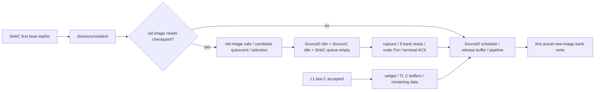

# 67,366 cycles：能恢复的边界与不可伪造的子阶段

| Measured phase | Total cycles | Episodes | Average | Median | p90 | p99 | Max |
|---|---:|---:|---:|---:|---:|---:|---:|
| first_C_to_last_C | 13,386 | 2231 | 6.000 | 6 | 6 | 6 | 6 |
| last_C_to_first_bank | 67,366 | 2231 | 30.195 | 43 | 43 | 56 | 76 |
| first_bank_to_last_bank | 15,617 | 2231 | 7.000 | 7 | 7 | 7 | 7 |
| last_bank_to_ACK | 4,546 | 2231 | 2.038 | 2 | 2 | 2 | 9 |

ROI2,231完整release，normal1,793笔prebank49,248、SVB438笔18,118；lastC→firstbank直方图主模式43和1。分位nearest-rank，区间左闭右开，首末bankspan7表示8次连续accepted写。

用户建议T1–T5不构成当前RTL的统一逐笔串行分解：**SinkC在首C beat就触发req/分配list**，directory及candidate可能在末C前开始；checkpoint不由每个release必然创建。L1末128bit C accepted也不是L2末64bit C accepted，中间还有width/buffer。不能默认entry ready在lastC之后，再将差值硬拆成正时间。

| Proposed phase | 对应实际节点 | Total/count/avg/median/p90/p99/max | Top-N |
|---|---|---|---|
| T1 lastC→entry ready | L1 C endpoint vs SinkC首beat req→directory/resident candidate；可能不同顺序 | 全部null，且非每C checkpoint | unavailable |
| T2 entry→eligible | old resident safe + quiescent +not preempted；非incoming image seq比较 | 全部null | unavailable |
| T3 eligible→selected | combinational固定priority选择；没选中的candidate等待可多cycle；非独立queue grant | 全部null | unavailable |
| T4 selected→bank grant | 包含drained、engine idle/capture、逐beatbs_adr.ready；不是一个grant | 全部null | unavailable |
| T5 grant→first write | checkpoint是bank**read**→old-image Put→ACK；新ReleaseData再经SourceD four-stage→bank**write** | 全部null | unavailable |

真实依赖图（条件分支，不能以未知阶段求总和）：

因此 **尚不能确定67,366主要属于哪一内部阶段**。已排除的只是末bank→ACK为主因及最终8个bank写之间长气泡；未证明43-cycle模式对应checkpoint。以本cohort观测最短1cycle作非因果参照，额外phase duration为65,135，但不能称RTL必需floor或可恢复收益。

最长20个可观测release代理见episode_analysis，不冒充preservation/outerA锁。SC38记录新ReleaseData写，完全不记录checkpoint旧image bank读；同line相邻事件不能替代missing capture/ACK事务。

补充长尾现象：prebank≥55的24笔，其firstbank cycles全部满足 `cycle mod40=4`，top20也均如此；43-cycle主模式的firstbank分布并不固定该相位。这是从当前尾部选择得到的时间模式，未保存memory/checkpoint ACK对应事件，不能据此断言DRAM/refresh为root cause。它支持后续检查服务/回执时序，不支持把长尾当成bank固定仲裁starvation。
