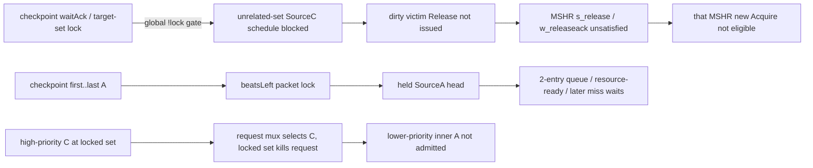

# HOL与循环依赖审查

## 已否定的长锁链

`C last → full preservation active → outer A packet locked until terminal ACK → all subsequent inner A blocked` 不是实际RTL。candidate可能先于lastC、pre-capture无packet锁、waitAck不再锁A、inner Get hits可走SourceD。不能为这条不存在的跨ACKpacket锁设计“提前释放到C末beat”的patch；C与A是两条不同消息。

## 仍存在的三条具体依赖

第一条在`Scheduler.scala:334–336,776–779`与`MSHR.scala:249`有精确条件，**structural path PROVEN**；它是否在B中发生、对哪个miss/head/package关键 **NOT_PROVEN**。这是下一离线资源目标，不继续笼统称outer A packet锁。

第三条源自`request.bits=Mux(sinkC.valid,C,Mux(sinkX.valid,X,clientA))`，然后对选择的set检查locked；clientA.ready还要求!C.valid&&!X.valid。一个不ready的高优先C可以挡无关A，不能因per-set lock就断言没有跨set入口HOL。改为skip locked C涉及incoming multibeat/C优先和deadlock设计，需另审。

## Circular wait检查

| 疑似循环 | 实际破环条件 | 结论 |
|---|---|---|
| pre-capture drain等A，而A等本checkpoint packet解锁 | checkpoint尚未capture/发A；`drainForCheckpoint`无普通A直接gate；unquiescent candidate不runnable不会请求global drain | 未发现此必然闭环 |
| checkpoint等bank、normal bank work又等checkpoint A | checkpoint挂SourceC优先端；只有SinkC更高，可在外部C缺beat/背压时等，但不是normalSourceD/SinkD抢占 | 无封闭自持环证明；外部C/downstream wait可能长 |
| waitAck持有packet锁，ACK所需正常A发不出 | final A已解packet锁，AccessAck由terminal完整Put返回且独立D ready=true | 跨ACK packet环否定 |
| waitAck禁SourceC，SourceC不发就checkpoint ACK不来 | checkpoint完整A已发送、source/txn独立；其ACK不依赖新的无关SourceC req | 未发现必要循环；却可造成victim/A delay |
| 新D multibeat挡旧ReleaseAck credit又不能继续D | SourceD separate ReleaseAck queue+`earlyD.valid=s3_valid_d&&s4_ready`已有防环 | 本轮不撤销该guard |

这不是所有cache/interconnect无deadlock的形式证明，也不是成功退出证明无stall。外部DRAM/Cork、Probe流、水位、peerWait还可引入长等待；现存数据不能封闭全系统依赖图。

锁粒度判断：target-set锁已per-set，不能提前到C末beat/末A或只按source释放；旧image terminalACK是正确性合同。outerA multibeat锁已仅必要packet周期，按source/subbank插队不合法。**全局SourceC预约在waitAck的范围比checkpoint物理读需求更宽**，值得审查按“仍需bank读”条件交还端口同时保留target-set锁，而不是删preservation。
