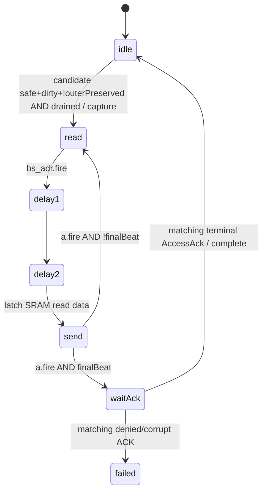

# Preservation真实状态机与资源

来源：`sifive-cache/.../inclusivecache/src/Scheduler.scala:186–275,312–338,770–817`，`L2Preservation.scala:1–160`、MSHR、SinkC、Directory；`source_evidence.json`保存当前source及completed-B generated对应方程。候选名称中的“entry/drain”必须区分C数据缓冲、组合candidate、snapshot和bank流水排空。

从任意active state，合法零延迟末beatACK可直接完成；错source/txn/opcode/size回执被忽略并计stale。snapshot保持set/way/tag/旧image/reason，serial64bit独立身份。水位合法之后才capture；不能用新image seq替代resident key。

| 问题 | RTL答案 |
|---|---|
| 1. entry创建处 | Scheduler从每MSHR resident+schedule.D组合生成candidate，另有first ProbeAckData candidate；L2Preservation唯一snapshot在capture边沿创建 |
| 2. trigger | resident hit且destructive change；`blocked=!safe(oldImage)||(dirty&&!outerPreserved)`；safe dirty old image需checkpoint，unsafe先等水位 |
| 3. 与C关系 | ReleaseData改变resident版本且非same-unsafe-package supersede可触发reason1；ProbeAckData为reason2；trusted A写为reason3；不是每个C都创建checkpoint |
| 4. buffer深度 | checkpoint engine1个candidate snapshot+单个64bit data寄存器，**不是64B queue**。ReleaseData另有SinkC2 lists/16×64bit beats；候选仍留在原MSHR/Probe入口，非独立preservation FIFO |
| 5. drain eligible | selectable candidate valid、对应MSHR`quiescent=w_rprobeacklast&&w_pprobeacklast&&w_grantlast`且old image safe；Probe候选quiescent常true |
| 6. 谁选择 | probe bit0优先，其后MSHR固定低索引；可runnable优先，否则valid优先。BC/C同set preempt可屏蔽低优先MSHR candidate；不是fair RR |
| 7. drain与bank竞争 | pre-capture先等现有SourceD/SourceC idle、SinkC已入bank queue为空、目标quiescent；之后checkpoint借SourceC bank读端，与SinkC最高优先端竞争 |
| 8. 需要哪些端口 | candidate来自已读resident，不新增tag lookup或replacement；capture自身不写data/dir；读取旧line需data SRAM read。完成更新匹配MSHR的outerPreserved，不在ACK边沿直接重写directory；后续dir publish仍需单端口directory调度 |
| 9. drain/操作完成 | pipeline drain=上述idle条件；checkpoint完成=全Put已发且匹配source2/64B/CachePreserveTxn的无错误AccessAck；二者不能同名 |
| 10. 哪个ACK等drain | checkpoint AccessAck先要capture/read/send；incoming L1 ReleaseAck须新ReleaseData最终bank commit，若旧image checkpoint必要会间接等其完成；无checkpoint的C也可直接写 |
| 11. outer A要等吗 | 正常outer A与pre-capture drain无直接global gate；仅已开始checkpoint packet及当周期更高优先preservation.valid挡SourceA dequeue。SourceA FIFO2可先enqueue |
| 12–15. 锁范围/顺序 | 详outer_a_lock_semantics；多beat锁per-packet共享输出，target-set锁per-set，SourceC预约却跨set全局持续active；normal victim的ReleaseAck→Acquire为独立MSHR顺序 |

`drainForCheckpoint=runnable.orR&&!preservation.lock.valid` 在capture前抑制新C和D schedule，不能描述为“停止所有请求”。普通A schedule可继续，入口directory/queue仍有门控；active之后该drainForCheckpoint为false，其他set D可以继续。target set通过locked(set)及物理写assert保护，直到matching ACK。

idle且unsafe candidate不具备capture条件，不应将其等待全部计为engine pending；candidate-valid/unsafe-watermark wait、runnable drain wait、active engine三类必须分别计数。现存engine counters(2)仅active cycles，未导出到B成功日志。
